# Rajasthan Royals SupeRR Selector Season 2 (Round 1)
## High-Pressure T20 Player Rating Engine & Recruitment Intelligence System

[](https://www.python.org/)
[](https://scikit-learn.org/)
[]()
[]()

> A statistically rigorous, reproducible cricket data science engine built for **Round 1 of Rajasthan Royals' SupeRR Selector Season 2**. Evaluates delivery-level leverage and contextual expectations across 200,999 IPL and T20 International deliveries (2022-2026), combines three distinct pressure modeling paradigms via consensus ensembling (Weighted Z-Score & Reciprocal Rank Fusion), and produces the authoritative **Top 10 Batters** and **Top 10 Bowlers** under pressure.

---

## Table of Contents
1. [Executive Summary & Challenge Statement](#1-executive-summary--challenge-statement)
2. [End-to-End System Architecture & Project Structure](#2-end-to-end-system-architecture--project-structure)
3. [Data Inventory, Scope & Relational Schema](#3-data-inventory-scope--relational-schema)
4. [Scientific Pressure Definition (Pressure Index)](#4-scientific-pressure-definition-pressure-index)
5. [Contextual Expected Outcome Baselines (xRuns & xWicket)](#5-contextual-expected-outcome-baselines-xruns--xwicket)
6. [The Three Pressure Modeling Paradigms](#6-the-three-pressure-modeling-paradigms)
7. [Consensus Ensemble Aggregation & Correlation Concordance](#7-consensus-ensemble-aggregation--correlation-concordance)
8. [Official Competition Submission: Top 15 Rankings & Unstop Quick-Reference](#8-official-competition-submission-top-15-rankings--unstop-quick-reference)
9. [Rajasthan Royals Tactical Relevance & Auction Scouting Overlay](#9-rajasthan-royals-tactical-relevance--auction-scouting-overlay)
10. [How to Run & Reproducibility Guide](#10-how-to-run--reproducibility-guide)
11. [Methodological Assumptions & Boundary Conditions](#11-methodological-assumptions--boundary-conditions)
12. [Reliability, Sensitivity Analysis & System Limitations](#12-reliability-sensitivity-analysis--system-limitations)

---

## 1. Executive Summary & Challenge Statement

### The Problem
Some players thrive when the match is on the line; others see their performance dip. Round 1 of the SupeRR Selector challenge tasks analysts with building a data-driven system to distinguish those who consistently rise to the occasion from those whose performances decline under pressure.

### Submission Requirements
1. **01 Player Rankings:** Two ordered top-10 lists submitted in exact rank order (1 to 10) via the Unstop dropdown fields:
   - **Top 10 Batters under pressure**
   - **Top 10 Bowlers under pressure**
   *(Includes Ranks 11-15 as immediate verified backups if any international player is absent from the Unstop selection menu).*
2. **02 Methodology Report:** Complete documentation explaining the mathematical definition of pressure, contextual baseline modeling, Bayesian shrinkage, consensus ensembling, and evidence for every selection.
3. **RR Tactical Scouting Layer:** Downstream strategic alignment mapping top clutch performers to Rajasthan Royals' squad vulnerabilities and home conditions (Sawai Mansingh Stadium, Jaipur & Barsapara Stadium, Guwahati).

---

## 2. End-to-End System Architecture & Project Structure

```mermaid
flowchart TD
    subgraph Ingestion["1. Raw Ingestion & Verification (./data)"]
        D1["ball_by_ball.csv (200,999 Deliveries)"]
        D2["matches.csv (883 Matches: IPL & T20I)"]
        D3["competitions.csv & teams.csv"]
        D4["playing_eleven.csv & mapping.csv"]
    end

    subgraph Cleaning["2. Match State Reconstruction"]
        C1["Innings Totals & Target Calibration (DLS Balls Handled)"]
        C2["Exclude Super Overs (innings 3 & 4)"]
        C3["Extras Accounting (extras1_runs enum vs physical runs)"]
        C4["Cumulative State (Balls Left, Runs Req, RRR, Wickets Fallen)"]
    end

    subgraph PressureEng["3. Continuous Pressure Engine (PI in 0 to 1)"]
        P1["Innings 2: RRR Urgency + Resource Scarcity + Match Closeness"]
        P2["Innings 1: Top-Order Collapse Urgency + Death Overs Accelerator"]
        P3["High-Pressure Threshold: PI >= 0.65 (Top 28.5% Leverage)"]
    end

    subgraph ContextModels["4. Contextual Expected Outcomes (LightGBM)"]
        E1["xRuns Bat & Bowl (Phase, Bowler Type, Wickets, Venue)"]
        E2["xWicket Bat & Bowl (Dismissal Expectancy)"]
        E3["Runs Added Above Expected (RAAE/100) & Runs Saved (RSAE/24)"]
    end

    subgraph Models["5. The Three Modeling Paradigms"]
        M1["Model 1: Contextual Value Added + Bayesian Shrinkage (K=40)"]
        M2["Model 2: Rate Elevation Delta (Delta SR, Delta Economy)"]
        M3["Model 3: Clutch Match Consistency & Reliability"]
    end

    subgraph Ensemble["6. Standardized Ensemble & Eligibility Filter"]
        F1["Active Filter (Latest Match >= 2025-01-01)"]
        F2["IPL Eligibility Filter (Exclude Pakistan-only, 68 removed)"]
        F3["Retired Player Filter (Vijay Shankar, Moeen Ali, etc. removed)"]
        F4["Sample Cutoff (>= 120 Legal HP Balls: 113 Batters, 123 Bowlers)"]
        F5["Weighted Z-Score (0.40 M1 + 0.35 M2 + 0.25 M3) + RRF Rank Fusion"]
    end

    subgraph Deliverables["7. Official Submission Deliverables"]
        O1["Top 15 Batters Under Pressure (outputs/top15_ensemble_batters.csv)"]
        O2["Top 15 Bowlers Under Pressure (outputs/top15_ensemble_bowlers.csv)"]
        O3["RR 2027 Auction Overlay Targets (outputs/rr_2027_auction_targets.csv)"]
        O4["Spearman Correlation & Robustness Tables"]
    end

    Ingestion --> Cleaning
    Cleaning --> PressureEng
    PressureEng --> ContextModels
    ContextModels --> Models
    Models --> Ensemble
    Ensemble --> Deliverables
```



### Project Directory Structure

```text
RR_IPL_Selection/
├── README.md                                  # Comprehensive technical report & documentation
├── run_data_audit.py                          # Phase 1: Relational schema & null-rate verification
├── build_superr_selector_engine.py            # Phase 2-4: PI calculation & LightGBM contextual modeling
├── build_final_ensemble_rankings.py           # Phase 5-6: Consensus ensembling & eligibility filtering
├── build_rr_auction_overlay.py                # Phase 7: RR 2027 auction recruitment engine
├── print_tables.py                            # CLI inspection utility for submission tables
├── data/                                      # Supplied tournament datasets (2022-2026)
│   ├── ball_by_ball.csv                       # 200,999 delivery-level events
│   ├── matches.csv                            # 883 match records (IPL + T20I)
│   ├── competitions.csv                       # 141 competition definitions
│   ├── teams.csv                              # 353 team mappings
│   ├── playing_eleven.csv                     # 28,381 player-match appearances
│   └── competition_teams_player_mapping.csv   # 6,413 player registrations & squads
├── docs/
│   └── data_audit.md                          # Full structural data dictionary & join audit
├── outputs/                                   # Final competition deliverables
│   ├── top15_ensemble_batters.csv             # Official Top 15 Batters under pressure
│   ├── top15_ensemble_bowlers.csv             # Official Top 15 Bowlers under pressure
│   ├── rr_2027_auction_targets.csv            # RR IPL 2027 Auction Recruitment Targets
│   ├── ensemble_correlation_matrix_batters.csv# Spearman correlation matrix (batters)
│   ├── ensemble_correlation_matrix_bowlers.csv# Spearman correlation matrix (bowlers)
│   ├── full_eligible_pool_batters.csv         # Complete standardized pool (N=113)
│   └── full_eligible_pool_bowlers.csv         # Complete standardized pool (N=123)
└── results/                                   # Diagnostic outputs, validation logs & charts
    ├── sensitivity_analysis.csv               # Multi-threshold sensitivity grid
    ├── pressure_definition_proof.csv          # Leverage separation evidence
    └── charts/                                # Generated diagnostic distributions
```

---

## 3. Data Inventory, Scope & Relational Schema

### Dataset Scope & Competition Breakdown

The tournament database comprises all men's professional T20 fixtures provided across the 2022–2026 cycle:

| Competition Scope | Matches | Deliveries | Knockout / Playoff Matches | Close Finishes (<= 9 runs / <= 2 wkts) | Evaluation Role |
| :--- | :---: | :---: | :---: | :---: | :--- |
| **Indian Premier League (IPL 2022–2026)** | 226 | 53,680 | 20 Playoff Matches | 48 Close Finishes | Primary franchise benchmark; grounds auction valuation & role calibration |
| **Men's T20 Internationals (T20I 2022–2026)** | 657 | 147,319 | 34 Tournament Knockouts | 92 Close Finishes | High-stakes international context (T20 World Cups, Asia Cups, Bilaterals) |
| **Complete Combined Universe** | **883** | **200,999** | **54 High-Stakes Fixtures** | **140 Close Finishes** | Total statistical sample for baseline training & pressure extraction |

The data directory (`./data` or `./6af3166e7b922_data_pack`) contains 6 core relational CSV files covering all IPL and Men's T20I matches from 2022 to 2026:

| File Name | Records | Columns | Size | Primary Entity / Grain | Integrity Status |
| :--- | :---: | :---: | :---: | :--- | :---: |
| `competitions.csv` | 141 | 4 | 0.01 MB | `comp_id` (IPL 2022-2026, World Cups, Bilaterals) | [PASS] 100% Mapped |
| `teams.csv` | 353 | 3 | 0.01 MB | `team_id` (38 Franchise & International squads) | [PASS] 100% Mapped |
| `matches.csv` | 883 | 22 | 0.12 MB | `match_id` (226 IPL matches, 657 T20Is) | [PASS] 100% Mapped |
| `playing_eleven.csv` | 28,381 | 9 | 0.92 MB | `match_id`, `player_id` (XI lineups & Impact subs) | [PASS] 100% Mapped |
| `competition_team_player_mapping.csv` | 6,413 | 6 | 0.44 MB | `comp_id`, `team_id`, `player_id` (Player registry) | [PASS] 100% Mapped |
| `ball_by_ball.csv` | 200,999 | 33 | 39.17 MB | `match_id`, `innings`, `overid`, `over_ball_num` | [PASS] 100% Mapped |

### Critical Domain Findings & Hygiene Rules
1. **The Extras Encoding Trap:** `extras1_runs` is **NOT** a run count. It is an internal integer category code matching `extras_type`:
   - `1 = Overstep (No-ball)`
   - `2 = Wide`
   - `3 = Legbyes`
   - `4 = Byes`
   - `5 = Other / Penalty`
   - `6 = Regular delivery`
   Physical extra runs conceded appear in `extras_2_runs` (e.g. overthrows or boundaries off a wide).

```text
Team Runs = runs + extras_2_runs + (1 if extras_type in ['wide', 'Overstep'] else 0) + (5 if extras_type == 'Penalty' else 0)

Bowler Runs Conceded = runs + (1 if extras_type in ['wide', 'Overstep'] else 0) + extras_2_runs
(Note: Byes and Leg-byes are fielding extras; they are NEVER charged to the bowler)

Batter Legal Delivery = (extras_type != 'wide')
Bowler Legal Delivery = (~extras_type.isin(['wide', 'Overstep']))
```

2. **Super Overs:** Innings 3 (25 balls) and 4 (13 balls) are excluded from standard 20-over win-expectancy models to avoid distorting leverage gradients.
3. **DLS Revisions:** In `matches.csv`, revised overs are stored in **BALLS** (e.g. `114.0` = 19 overs, `84.0` = 14 overs). Balls remaining and required targets are calibrated against revised targets.
4. **Legitimate Bowler Wickets:** Only bowler dismissals (*Bowled, Caught, LBW, Stumped, Hit Wicket*) are credited. Run-outs and retired hurts are strictly excluded from bowler metrics.
5. **Retired & Inactive Player Filtering:** Confirmed retired players (including Vijay Shankar, Moeen Ali, Dinesh Karthik, Shikhar Dhawan, Kieron Pollard, Ambati Rayudu, Suresh Raina) are explicitly excluded via `RETIRED_EXCLUSION_LIST` along with any player without active appearances post-2025 (`latest_match_date < '2025-01-01'`).

---

## 4. Scientific Pressure Definition (Pressure Index)

Rather than arbitrarily defining pressure as "the last 5 overs," the system defines a continuous, delivery-level **Pressure Index (PI in [0, 1])** calculated immediately before each ball:

### Chasing Innings (Innings = 2)
In chases, leverage is driven by required run rate urgency, remaining batting resources, and contest closeness:

```text
PI_chase = 0.45 * P_RRR + 0.35 * P_Scarcity + 0.20 * P_Closeness

Where:
P_RRR      = clip((Required_Run_Rate - 6.5) / (16.5 - 6.5), 0.0, 1.0)
P_Scarcity = 1.0 - [((10 - Wickets_Lost) / 10.0) * (Balls_Remaining / Max_Balls)]
P_Closeness = exp(-0.5 * ((Required_Run_Rate - 11.5) / 4.0)^2)
```

Dead-rubber penalty: If a match is effectively sealed (e.g. chasing team needs <= 6 runs off >= 18 balls with <= 4 wickets lost, or needs >= 36 off 6 balls), `PI_chase` is capped at `0.30` to avoid misclassifying dead overs as pressure.

### Batting-First Innings (Innings = 1)
In the first innings, pressure emerges from top-order batting collapses or late-innings acceleration urgency:

```text
PI_first = max(PI_base, P_collapse, P_death)

Where:
PI_base    = Phase_Base + (Wickets_Lost / 10.0) * 0.30
             (Phase_Base = 0.20 for Overs 1-6, 0.35 for Overs 7-15, 0.60 for Overs 16-20)
P_collapse = max(
               0.62 + 0.10 * (Wickets_Lost - 3) if (Over <= 8 and Wickets_Lost >= 3) else 0.0,
               0.65 + 0.10 * (Wickets_Lost - 4) if (Over <= 12 and Wickets_Lost >= 4) else 0.0
             )
P_death    = 0.52 + 0.28 * ((Over - 15) / 5.0)  (for Overs 16-20)
```

Playoff Match Multiplier: Deliveries in knockout matches, qualifiers, and finals receive a `1.15x` high-stakes multiplier.

### Empirical Separation Proof (PI >= 0.65 vs. Normal Play)

```text
High-Pressure Cutoff: PI >= 0.65 (Isolates the top 28.55% highest-leverage deliveries)
```

| Match State | Deliveries | Wicket Rate (Wkts/Over) | Dot Ball % | Boundary % | Run Rate (RPO) |
| :--- | :---: | :---: | :---: | :---: | :---: |
| **Normal Situation (PI < 0.65)** | 143,570 (71.45%) | 0.29 wkts/over | 34.2% | 16.8% | 8.12 |
| **High Pressure (PI >= 0.65)** | **57,391 (28.55%)** | **0.46 wkts/over** | **41.8%** | **14.2%** | **7.54** |
| **Statistical Shift** | - | **+58.6% Dismissal Surge** | **+7.6% Dots** | **-2.6% Boundaries** | **Suppressed Scoring** |

Under `PI >= 0.65`, wicket hazard surges by **+58.6%** and dot-ball percentage increases by **+7.6%**, proving that this mathematical cutoff isolates genuine, high-stakes pressure situations.

---

## 5. Contextual Expected Outcome Baselines (xRuns & xWicket)

Raw strike rate or raw economy is heavily distorted by match situation. A strike rate of 140 in the Powerplay against spin is ordinary; a strike rate of 140 when batting with 7 wickets down against extreme pace at the death is world-class.

To establish objective baselines, we train LightGBM gradient boosted models across all 200,961 deliveries using:
- `innings` (1st vs 2nd innings)
- `overid` (over number 1 to 20)
- `over_ball_num` (ball number 1 to 6)
- `wickets_lost` (0 to 9 wickets fallen)
- `pace_or_spin` (Pace vs. Spin bowling type)
- `venue_id` (ground-specific par score context)
- `comp_id` (IPL vs. International T20 context)

### Delivery-Level Contextual Metrics:
```text
For Batters:
xRuns_bat  = Expected runs scored off delivery
xWkt_bat   = Expected probability of striker dismissal
RAAE/100   = Runs Added Above Expected per 100 balls
           = [(Actual_Runs_Scored - xRuns_bat) / HighPressure_Balls] * 100

For Bowlers:
xRuns_bowl = Expected runs conceded off delivery
xWkt_bowl  = Expected probability of bowler dismissal
RSAE/24    = Runs Saved Above Expected per 24 balls (4 overs)
           = [(xRuns_bowl - Actual_Runs_Conceded) / HighPressure_Balls] * 24
```

### Empirical Bayes Shrinkage (K = 40)
To prevent small-sample outliers (e.g. a batter facing only 30 pressure balls with an inflated strike rate) from distorting the rankings, Empirical Bayes shrinkage regresses raw performance toward the qualified peer group mean:

```text
Shrinkage_Weight (w) = HighPressure_Balls / (HighPressure_Balls + K)
(where K = 40.0)

Shrunk_Metric = w * Raw_Metric + (1 - w) * Population_Mean
```

---

## 6. The Three Pressure Modeling Paradigms

Rather than relying on a single isolated metric, the engine synthesizes three distinct modeling paradigms:

### Model 1 (M1): Contextual ML Expectation Model (Primary Model)
Measures context-adjusted runs generated or saved above expectation, reinforced by wicket preservation and Bayesian shrinkage:
```text
Batting Score M1 = Shrunk_RAAE_100 + 5.0 * (Expected_Outs / Actual_Outs)
Bowling Score M1 = Shrunk_RSAE_24  + 0.5 * (Actual_Wickets - Expected_Wickets)
```

### Model 2 (M2): Performance Elevation / Baseline Delta Model
Measures whether a player elevates above their own personal baseline when pressure mounts:
```text
Delta_SR   = Pressure_Strike_Rate - Usual_Strike_Rate
Delta_Econ = Usual_Economy - Pressure_Economy  (Positive indicates runs suppressed)

Batting Score M2 = Delta_SR + 0.3 * (Pressure_Strike_Rate - 135.0)
Bowling Score M2 = Delta_Econ + 0.3 * (8.50 - Pressure_Economy)
```

### Model 3 (M3): Clutch Match Consistency & Reliability Model
Evaluates match-to-match resilience (% of high-pressure match appearances where the player generated positive impact) scaled by sample volume:
```text
Consistency_Pct = (HighPressure_Matches_With_Positive_Impact / Total_Evaluated_HP_Matches) * 100

Score M3 = Consistency_Pct * log10(HighPressure_Balls)
```

---

## 7. Consensus Ensemble Aggregation & Correlation Concordance

### Standardization & Combination Formula
1. Compute standardized Z-scores for each model separately across the filtered eligible pool:
```text
Z_score = (Score - Mean) / Standard_Deviation
```
2. Compute the **Weighted Z-Score Ensemble**:
```text
Weighted_Z = 0.40 * Z_M1 + 0.35 * Z_M2 + 0.25 * Z_M3
```
3. Compute the **Equal-Weight Z-Score** and **Reciprocal Rank Fusion (RRF)**:
```text
Equal_Z   = (Z_M1 + Z_M2 + Z_M3) / 3.0
RRF_Score = [1.0 / (10 + Rank_M1)] + [1.0 / (10 + Rank_M2)] + [1.0 / (10 + Rank_M3)]
```
4. Rescale the Final Ensemble Score to a 0 to 100 scale:
```text
Final_Ensemble_Score = [(Weighted_Z - Min_Z) / (Max_Z - Min_Z)] * 100.0
```

### Spearman Rank Correlation Matrices

#### Batting Models Correlation Matrix (N = 113 Qualified Batters)
| Model Metric | Model 1 (Contextual) | Model 2 (Delta SR) | Model 3 (Consistency) | Equal Z | Weighted Z (Ensemble) | RRF Score |
| :--- | :---: | :---: | :---: | :---: | :---: | :---: |
| **Model 1 (Contextual ML)** | **1.0000** | 0.6727 | 0.7947 | 0.9141 | **0.9200** | 0.9240 |
| **Model 2 (Delta SR)** | 0.6727 | **1.0000** | 0.5698 | 0.8479 | **0.8649** | 0.8334 |
| **Model 3 (Consistency)** | 0.7947 | 0.5698 | **1.0000** | 0.8711 | **0.8463** | 0.8682 |
| **Equal Z-Score** | 0.9141 | 0.8479 | 0.8711 | **1.0000** | 0.9971 | 0.9845 |
| **Weighted Z (Ensemble)** | **0.9200** | **0.8649** | **0.8463** | 0.9971 | **1.0000** | **0.9833** |
| **RRF Score** | 0.9240 | 0.8334 | 0.8682 | 0.9845 | **0.9833** | **1.0000** |

#### Bowling Models Correlation Matrix (N = 123 Qualified Bowlers)
| Model Metric | Model 1 (Contextual) | Model 2 (Delta Econ) | Model 3 (Consistency) | Equal Z | Weighted Z (Ensemble) | RRF Score |
| :--- | :---: | :---: | :---: | :---: | :---: | :---: |
| **Model 1 (Contextual ML)** | **1.0000** | 0.6024 | 0.7029 | 0.8871 | **0.9057** | 0.8559 |
| **Model 2 (Delta Econ)** | 0.6024 | **1.0000** | 0.4536 | 0.7962 | **0.8139** | 0.8085 |
| **Model 3 (Consistency)** | 0.7029 | 0.4536 | **1.0000** | 0.8241 | **0.8072** | 0.8278 |
| **Equal Z-Score** | 0.8871 | 0.7962 | 0.8241 | **1.0000** | 0.9958 | 0.9825 |
| **Weighted Z (Ensemble)** | **0.9057** | **0.8139** | **0.8072** | 0.9958 | **1.0000** | **0.9789** |
| **RRF Score** | 0.8559 | 0.8085 | 0.8278 | 0.9825 | **0.9789** | **1.0000** |

> **Mathematical Proof:** The Weighted Z-Score Ensemble correlates at **Rho = 0.9833** (batters) and **Rho = 0.9789** (bowlers) with Reciprocal Rank Fusion (RRF), proving extreme mathematical convergence between rank-based and score-based aggregation.

---

## 8. Official Competition Submission: Top 15 Rankings & Unstop Quick-Reference

### A. Top 15 Batters Under Pressure (Ensemble Ranking)

*(Vijay Shankar and Moeen Ali confirmed retired; excluded from active eligibility).*

| Final Rank | Player ID | Player Name (Dropdown Selection) | HP Balls | Pressure SR | Usual SR | Delta SR | RAAE/100 | Consistency % | Rank M1 (Z_M1) | Rank M2 (Z_M2) | Rank M3 (Z_M3) | RRF Score | Final Score (0-100) | IPL Team Mapping |
| :---: | :---: | :--- | :---: | :---: | :---: | :---: | :---: | :---: | :---: | :---: | :---: | :---: | :---: | :--- |
| **1** | `1699` | **Suryakumar Yadav** | 655 | 195.7 | 157.3 | +38.4 | +37.09 | 78.9% | 2 (+2.38) | 3 (+1.88) | 1 (+2.77) | 0.2512 | **100.00** | Mumbai Indians |
| **2** | `4117` | **Ishan Kishan** | 349 | 189.7 | 139.0 | +50.6 | +27.82 | 76.0% | 6 (+1.71) | 1 (+2.34) | 5 (+1.92) | 0.2201 | **93.04** | Mumbai Indians, Sunrisers Hyderabad |
| **3** | `7216` | **Prabhsimran Singh** | 129 | 196.9 | 155.7 | +41.2 | +38.27 | 66.7% | 3 (+2.29) | 2 (+2.02) | 41 (+0.37) | 0.1799 | **87.22** | Punjab Kings |
| **4** | `6281` | **Abhishek Sharma** | 216 | 193.5 | 186.3 | +7.2 | +42.14 | 80.0% | 1 (+2.59) | 39 (+0.44) | 6 (+1.73) | 0.1738 | **85.28** | Sunrisers Hyderabad |
| **5** | `1318` | **Andre Russell** | 479 | 180.6 | 153.1 | +27.4 | +30.39 | 68.8% | 5 (+1.91) | 15 (+1.18) | 7 (+1.65) | 0.1655 | **84.55** | Kolkata Knight Riders |
| **6** | `6396` | **Tim David** | 622 | 182.3 | 172.8 | +9.5 | +30.43 | 71.1% | 4 (+1.93) | 42 (+0.39) | 3 (+2.08) | 0.1676 | **81.04** | Mumbai Indians, Royal Challengers Bengaluru |
| **7** | `4369` | **Shai Hope** | 162 | 179.6 | 138.1 | +41.6 | +24.96 | 71.4% | 10 (+1.41) | 5 (+1.80) | 17 (+0.87) | 0.1537 | **80.72** | Delhi Capitals |
| **8** | `7260` | **Dhruv Jurel** | 379 | 174.7 | 130.1 | +44.6 | +19.85 | 62.5% | 16 (+1.12) | 4 (+1.87) | 14 (+0.97) | 0.1516 | **79.20** | Rajasthan Royals |
| **9** | `3374` | **Mark Chapman** | 315 | 169.8 | 129.9 | +39.9 | +26.23 | 58.3% | 7 (+1.58) | 7 (+1.59) | 35 (+0.52) | 0.1399 | **78.69** | New Zealand (Intl) |
| **10** | `4391` | **Liam Livingstone** | 413 | 169.0 | 143.2 | +25.8 | +21.17 | 69.0% | 17 (+1.04) | 19 (+0.95) | 8 (+1.54) | 0.1271 | **74.59** | Punjab Kings, Royal Challengers Bengaluru, Sunrisers Hyderabad |
| *11 (Backup)* | `4260` | Heinrich Klaasen | 666 | 170.9 | 163.1 | +7.8 | +22.38 | 71.4% | 11 (+1.33) | 52 (+0.16) | 2 (+2.17) | 0.1471 | 74.55 | Sunrisers Hyderabad |
| *12 (Backup)* | `6931` | Pathum Nissanka | 174 | 155.2 | 133.0 | +22.2 | +27.65 | 75.0% | 9 (+1.45) | 31 (+0.60) | 11 (+1.17) | 0.1246 | 73.53 | Delhi Capitals, Sri Lanka |
| *13 (Backup)* | `23450` | Sai Sudharsan | 265 | 176.2 | 144.1 | +32.1 | +19.67 | 63.2% | 18 (+1.02) | 11 (+1.33) | 23 (+0.73) | 0.1136 | 72.93 | Gujarat Titans |
| *14 (Backup)* | `4703` | Rishabh Pant | 365 | 172.3 | 130.9 | +41.5 | +18.38 | 56.0% | 25 (+0.84) | 6 (+1.70) | 39 (+0.45) | 0.1115 | 72.70 | Delhi Capitals, Lucknow Super Giants |
| *15 (Backup)* | `4853` | Glenn Phillips | 367 | 172.8 | 136.5 | +36.3 | +16.80 | 62.5% | 27 (+0.71) | 9 (+1.47) | 15 (+0.95) | 0.1197 | 72.44 | Sunrisers Hyderabad, Gujarat Titans |

*(Note: If Rank 9 Mark Chapman is not listed in Unstop's dropdown due to being an international without recent IPL appearances, Rank 11 Heinrich Klaasen slides directly into the Top 10).*

---

### B. Top 15 Bowlers Under Pressure (Ensemble Ranking)

| Final Rank | Player ID | Player Name (Dropdown Selection) | HP Balls | Pressure Econ | Usual Econ | Delta Econ | RSAE/24 | Consistency % | Rank M1 (Z_M1) | Rank M2 (Z_M2) | Rank M3 (Z_M3) | RRF Score | Final Score (0-100) | IPL Team Mapping |
| :---: | :---: | :--- | :---: | :---: | :---: | :---: | :---: | :---: | :---: | :---: | :---: | :---: | :---: | :--- |
| **1** | `27960` | **Mayank Yadav** | 192 | 7.06 | 9.99 | +2.93 | +6.03 | 72.2% | 9 (+1.56) | 2 (+2.87) | 15 (+1.07) | 0.1760 | **100.00** | Lucknow Super Giants |
| **2** | `2382` | **Jamie Overton** | 177 | 6.41 | 9.27 | +2.86 | +5.08 | 73.3% | 11 (+1.45) | 1 (+2.97) | 16 (+1.07) | 0.1770 | **99.82** | Chennai Super Kings |
| **3** | `781` | **Sunil Narine** | 477 | 6.35 | 6.94 | +0.59 | +7.56 | 76.7% | 5 (+2.09) | 9 (+1.25) | 3 (+2.30) | 0.1962 | **98.79** | Kolkata Knight Riders |
| **4** | `8661` | **Matheesha Pathirana** | 564 | 7.37 | 8.19 | +0.81 | +4.96 | 68.4% | 3 (+2.42) | 13 (+1.19) | 8 (+1.78) | 0.1760 | **98.27** | Chennai Super Kings, Kolkata Knight Riders |
| **5** | `2933` | **Jasprit Bumrah** | 468 | 6.77 | 6.88 | +0.11 | +8.92 | 77.3% | 4 (+2.37) | 22 (+0.79) | 2 (+2.32) | 0.1860 | **97.59** | Mumbai Indians |
| **6** | `6256` | **Varun Chakravarthy** | 817 | 7.66 | 7.90 | +0.24 | +2.53 | 66.2% | 2 (+2.50) | 26 (+0.69) | 5 (+1.91) | 0.1778 | **95.36** | Kolkata Knight Riders |
| **7** | `4900` | **Wanindu Hasaranga** | 657 | 7.74 | 7.93 | +0.19 | +0.83 | 52.8% | 1 (+3.05) | 32 (+0.63) | 29 (+0.59) | 0.1404 | **91.93** | Royal Challengers Bengaluru, Sunrisers Hyderabad, Rajasthan Royals, Lucknow Super Giants |
| **8** | `4101` | **Mitchell Santner** | 491 | 7.05 | 7.26 | +0.21 | +5.59 | 74.4% | 7 (+1.85) | 21 (+0.80) | 4 (+2.14) | 0.1625 | **91.10** | Chennai Super Kings, Mumbai Indians |
| **9** | `2687` | **Roston Chase** | 216 | 7.14 | 7.72 | +0.58 | +8.33 | 89.5% | 12 (+1.35) | 15 (+1.07) | 1 (+2.40) | 0.1764 | **90.01** | West Indies (Intl) |
| **10** | `2681` | **Taskin Ahmed** | 256 | 7.05 | 7.89 | +0.83 | +3.03 | 60.6% | 6 (+2.01) | 8 (+1.28) | 36 (+0.50) | 0.1398 | **86.42** | Bangladesh (Intl) |
| *11 (Backup)* | `2417` | Akeal Hosein | 332 | 6.74 | 7.72 | +0.98 | +3.78 | 67.7% | 15 (+1.19) | 6 (+1.46) | 14 (+1.25) | 0.1442 | 84.41 | Sunrisers Hyderabad, Chennai Super Kings |
| *12 (Backup)* | `6669` | Mohsin Khan | 185 | 7.85 | 8.26 | +0.42 | +4.51 | 72.2% | 8 (+1.77) | 23 (+0.78) | 19 (+1.04) | 0.1203 | 82.80 | Lucknow Super Giants |
| *13 (Backup)* | `4722` | Rashid Khan | 902 | 7.44 | 7.28 | -0.16 | +2.76 | 64.1% | 10 (+1.52) | 44 (+0.44) | 7 (+1.81) | 0.1273 | 82.19 | Gujarat Titans |
| *14 (Backup)* | `39657` | Eshan Malinga | 228 | 7.32 | 9.00 | +1.68 | +4.55 | 69.6% | 27 (+0.69) | 5 (+1.86) | 18 (+1.05) | 0.1294 | 81.49 | Sunrisers Hyderabad |
| *15 (Backup)* | `4489` | Prasidh Krishna | 395 | 8.28 | 8.96 | +0.68 | +3.65 | 62.5% | 14 (+1.24) | 19 (+0.88) | 20 (+0.99) | 0.1095 | 77.96 | Rajasthan Royals, Gujarat Titans |

*(Note: If Rank 9 Roston Chase or Rank 10 Taskin Ahmed are not present in Unstop's dropdown, Rank 11 Akeal Hosein and Rank 12 Mohsin Khan serve as immediate drop-in replacements).*

---

### C. Unstop Official Dropdown Submission Quick-Reference

For seamless, error-free form completion on the Unstop portal, the following two tables list the exact dropdown target selections in order:

#### Official Top 10 Batters (Unstop Submission Order)
| Dropdown Rank | Player Name | Player ID | Primary Franchise / Country | Selection Status / Fallback Rule |
| :---: | :--- | :---: | :--- | :--- |
| **1** | **Suryakumar Yadav** | `1699` | Mumbai Indians | Direct Dropdown Selection |
| **2** | **Ishan Kishan** | `4117` | Mumbai Indians / SRH | Direct Dropdown Selection |
| **3** | **Prabhsimran Singh** | `7216` | Punjab Kings | Direct Dropdown Selection |
| **4** | **Abhishek Sharma** | `6281` | Sunrisers Hyderabad | Direct Dropdown Selection |
| **5** | **Andre Russell** | `1318` | Kolkata Knight Riders | Direct Dropdown Selection |
| **6** | **Tim David** | `6396` | Mumbai Indians / RCB | Direct Dropdown Selection |
| **7** | **Shai Hope** | `4369` | Delhi Capitals | Direct Dropdown Selection |
| **8** | **Dhruv Jurel** | `7260` | Rajasthan Royals | Direct Dropdown Selection |
| **9** | **Mark Chapman** | `3374` | New Zealand (Intl) | Primary Selection *(If absent from dropdown, select Rank 11 Heinrich Klaasen)* |
| **10** | **Liam Livingstone** | `4391` | PBKS / RCB / SRH | Direct Dropdown Selection |
| *Backup 11* | *Heinrich Klaasen* | `4260` | Sunrisers Hyderabad | Verified Immediate Drop-in Backup |
| *Backup 12* | *Pathum Nissanka* | `6931` | Delhi Capitals / Sri Lanka | Verified Immediate Drop-in Backup |
| *Backup 13* | *Sai Sudharsan* | `23450` | Gujarat Titans | Verified Immediate Drop-in Backup |
| *Backup 14* | *Rishabh Pant* | `4703` | Delhi Capitals / LSG | Verified Immediate Drop-in Backup |
| *Backup 15* | *Glenn Phillips* | `4853` | SRH / Gujarat Titans | Verified Immediate Drop-in Backup |

#### Official Top 10 Bowlers (Unstop Submission Order)
| Dropdown Rank | Player Name | Player ID | Primary Franchise / Country | Selection Status / Fallback Rule |
| :---: | :--- | :---: | :--- | :--- |
| **1** | **Mayank Yadav** | `27960` | Lucknow Super Giants | Direct Dropdown Selection |
| **2** | **Jamie Overton** | `2382` | Chennai Super Kings | Direct Dropdown Selection |
| **3** | **Sunil Narine** | `781` | Kolkata Knight Riders | Direct Dropdown Selection |
| **4** | **Matheesha Pathirana** | `8661` | CSK / KKR | Direct Dropdown Selection |
| **5** | **Jasprit Bumrah** | `2933` | Mumbai Indians | Direct Dropdown Selection |
| **6** | **Varun Chakravarthy** | `6256` | Kolkata Knight Riders | Direct Dropdown Selection |
| **7** | **Wanindu Hasaranga** | `4900` | RCB / SRH / RR / LSG | Direct Dropdown Selection |
| **8** | **Mitchell Santner** | `4101` | Chennai Super Kings / MI | Direct Dropdown Selection |
| **9** | **Roston Chase** | `2687` | West Indies (Intl) | Primary Selection *(If absent from dropdown, select Rank 11 Akeal Hosein)* |
| **10** | **Taskin Ahmed** | `2681` | Bangladesh (Intl) | Primary Selection *(If absent from dropdown, select Rank 12 Mohsin Khan)* |
| *Backup 11* | *Akeal Hosein* | `2417` | Sunrisers Hyderabad / CSK | Verified Immediate Drop-in Backup |
| *Backup 12* | *Mohsin Khan* | `6669` | Lucknow Super Giants | Verified Immediate Drop-in Backup |
| *Backup 13* | *Rashid Khan* | `4722` | Gujarat Titans | Verified Immediate Drop-in Backup |
| *Backup 14* | *Eshan Malinga* | `39657` | Sunrisers Hyderabad | Verified Immediate Drop-in Backup |
| *Backup 15* | *Prasidh Krishna* | `4489` | Rajasthan Royals / GT | Verified Immediate Drop-in Backup |

---

## 9. Rajasthan Royals Tactical Relevance & Auction Scouting Overlay

> **Strict Rule Compliance:** The official Round 1 Top 10 Batters and Top 10 Bowlers rankings remain **completely unfiltered across all franchises**. This section provides a secondary recruitment overlay for the RR management team.

### Auction Portfolio Context
- **Remaining Purse:** ₹27.05 Cr
- **Available Squad Slots:** 6 slots total (3 Overseas slots maximum)
- **19 Retained / Traded-In Players (Excluded from targets):** `Riyan Parag`, `Yashasvi Jaiswal`, `Vaibhav Sooryavanshi`, `Ravindra Jadeja`, `Dhruv Jurel`, `Jofra Archer`, `Mohammed Shami`, `Manimaran Siddharth`, `Ravi Bishnoi`, `Sandeep Sharma`, `Nandre Burger`, `Shubham Dubey`, `Aman Rao Perala`, `Dasun Shanaka`, `Donovan Ferreira`, `Lhuan-dre Pretorius`, `Sushant Mishra`, `Yash Punja`, `Brijesh Sharma`.

### Secondary Recruitment Targets (`outputs/rr_2027_auction_targets.csv`)

| Target Priority | Role Category | Player Name | Nationality | Overseas Slot | Death HP Balls | Key Death Metric (Overs 15-20 / 16-20) | Overall Score | Est. Valuation | Tactical Rationale & Venue Fit |
| :--- | :--- | :--- | :---: | :---: | :---: | :---: | :---: | :---: | :--- |
| **Tier 1 (Marquee)** | **Role A: Finisher (No. 5-7)** | **Glenn Phillips** | Overseas | Yes | 146 | **198.63 SR** (+41.16 RAAE/100) | 72.44 | ₹6.0 - 8.5 Cr | Direct Hetmyer replacement. 360° boundary hitter against pace and spin; gun boundary fielder & backup off-spin. |
| **Tier 1 (Indian Value)** | **Role A: Finisher (No. 5-7)** | **Ashutosh Sharma** | Indian | No | 120 | **195.00 SR** (+41.10 RAAE/100) | 68.80 | ₹3.5 - 5.5 Cr | High-impact domestic Indian finisher. Preserves overseas slot; frees purse for premier death bowling. |
| **Tier 2 (Power Hitter)** | **Role A: Finisher (No. 5-7)** | **Liam Livingstone** | Overseas | Yes | 245 | **199.59 SR** (+39.46 RAAE/100) | 74.59 | ₹7.0 - 9.5 Cr | Ex-RR familiarity. Power to clear SMS Jaipur's 70m+ square boundaries; dual off-spin/leg-spin utility. |
| **Tier 2 (Indian WK-Bat)** | **Role A: Finisher (No. 5-7)** | **Jitesh Sharma** | Indian | No | 235 | **194.47 SR** (+33.78 RAAE/100) | 67.20 | ₹4.0 - 6.0 Cr | Counter-attacking WK-finisher. Partners with Dhruv Jurel at 5-6, providing flexible depth. |
| **Tier 3 (Tactical Value)** | **Role A: Finisher (No. 5-7)** | **Nitish Rana** | Indian | No | 57 | **200.00 SR** (+35.49 RAAE/100) | 65.40 | ₹2.0 - 3.5 Cr | Left-handed stabilizer capable of 200+ death acceleration. Solves middle-overs spin matchups. |
| **Tier 1 (Overseas Lock)** | **Role B: Death Pacer (16-20)** | **Matheesha Pathirana** | Overseas | Yes | 373 | **7.96 Econ** (+5.32 RSAE/24) | 98.27 | ₹9.0 - 12.0 Cr | Gold standard slinging yorkers; sub-8.0 RPO death economy. Workload insulation for Archer and Shami. |
| **Tier 1 (Left-Arm Pace)** | **Role B: Death Pacer (16-20)** | **Spencer Johnson** | Overseas | Yes | 63 | **8.19 Econ** (+5.65 RSAE/24) | 75.80 | ₹5.0 - 7.5 Cr | 145+ km/h left-arm angle with steep bounce. Highest death dot-ball rate (44.4%) among all evaluated pacers. |
| **Tier 2 (Pace Workhorse)** | **Role B: Death Pacer (16-20)** | **Taskin Ahmed** | Overseas | Yes | 133 | **7.98 Econ** (+4.20 RSAE/24) | 86.42 | ₹3.0 - 4.5 Cr | Skiddy high-pace bowler with tournament pedigree. Yields sub-8.0 death RPO; budget-friendly marquee alternative. |
| **Tier 2 (SMS Hard Length)**| **Role B: Death Pacer (16-20)** | **Prasidh Krishna** | Indian | No | 201 | **9.34 Econ** (+1.15 RSAE/24) | 77.96 | ₹4.0 - 6.0 Cr | Ex-RR pacer; high-release hard-length bounce protects expansive SMS Jaipur square boundaries. |
| **Tier 3 (Cutter Specialist)**| **Role B: Death Pacer (16-20)** | **Mustafizur Rahman** | Overseas | Yes | 396 | **8.71 Econ** (+3.35 RSAE/24) | 74.20 | ₹2.5 - 4.0 Cr | Proven slower-cutter master; off-cutter grips exceptionally on abrasive Jaipur pitches to induce mishits. |

---

## 10. How to Run & Reproducibility Guide

### Prerequisites & Environment Setup
To ensure exact reproduction across any environment (Windows, macOS, Linux):

```bash
# Recommended: Python 3.10+
python --version

# (Optional) Create and activate virtual environment
python -m venv venv
# Windows (PowerShell):
.\venv\Scripts\activate
# Linux/macOS:
source venv/bin/activate

# Install core scientific and machine learning dependencies
pip install lightgbm scikit-learn pandas numpy scipy tabulate
```

### Quick Start: Run Final Consensus Aggregation
```powershell
python build_final_ensemble_rankings.py
```
This script executes the complete filtering, Model 1-3 standardization, Z-score weighting, RRF rank fusion, and exports the final Top 15 CSVs and correlation matrices.

### Run RR Auction Scouting Overlay
```powershell
python build_rr_auction_overlay.py
```
Generates `outputs/rr_2027_auction_targets.csv` targeting Roles A & B within RR's ₹27.05 Cr purse.

### Run Full Modular Pipeline End-to-End
```powershell
# 1. Structural Data Audit & Join Verification
python run_data_audit.py

# 2. Build Continuous Pressure Features & LightGBM Models
python build_superr_selector_engine.py

# 3. Execute Final Ensemble & Active IPL Filtering
python build_final_ensemble_rankings.py

# 4. Generate Secondary RR Auction Scouting Overlay
python build_rr_auction_overlay.py
```

### Generated Output Files
All results are automatically persisted to `./outputs/` and `./results/`:
- `outputs/top15_ensemble_batters.csv`  -  Official Round 1 Top 15 Batters under pressure.
- `outputs/top15_ensemble_bowlers.csv`  -  Official Round 1 Top 15 Bowlers under pressure.
- `outputs/rr_2027_auction_targets.csv`  -  Secondary RR IPL 2027 Auction Scouting Targets (Roles A & B).
- `outputs/full_eligible_pool_batters.csv`  -  Complete standardized metrics for all qualified batters.
- `outputs/full_eligible_pool_bowlers.csv`  -  Complete standardized metrics for all qualified bowlers.
- `outputs/ensemble_correlation_matrix_batters.csv`  -  Spearman correlation matrix across all models.
- `outputs/ensemble_correlation_matrix_bowlers.csv`  -  Spearman correlation matrix across all models.
- `docs/data_audit.md`  -  Complete structural schema and data dictionary report.

---

## 11. Methodological Assumptions & Boundary Conditions

To maintain complete scientific rigor and full comparability across batters and bowlers, the system formalizes nine fundamental domain assumptions:

1. **Extras Accounting & Delivery Physics:**
   - In `ball_by_ball.csv`, `extras1_runs` represents an integer category code (`1=Overstep, 2=Wide, 3=Legbyes, 4=Byes, 5=Penalty, 6=Regular`), NOT extra runs. Physical runs conceded beyond standard penalties appear in `extras_2_runs`.
   - Wides and No-balls incur a +1 run penalty to team score and bowler runs conceded.
   - Byes and Leg-byes are credited as team runs, but are strictly excluded from bowler runs conceded.
2. **Batter & Bowler Legal Delivery Definition:**
   - A legal ball faced by a batter is defined as `extras_type != 'wide'`.
   - A legal ball bowled by a bowler is defined as `extras_type not in ['wide', 'Overstep']`.
3. **Dot Ball Physics:**
   - A batter dot ball is a legal delivery where the striker scored exactly 0 runs off the bat. If byes or leg-byes are run off a delivery where 0 runs were scored off the bat, it counts as a dot ball for the bowler, but NOT for the batter.
4. **Wicket Attribution:**
   - Bowler wickets are strictly credited for bowler dismissals (*Bowled, Caught, LBW, Stumped, Hit Wicket*). Run-outs and retired outs are credited to team wickets fallen for state tracking, but never to the bowler's individual wicket tally.
5. **Target & DLS Overs Calibration:**
   - In batting-second chases, the target is computed as `First_Innings_Runs + 1`.
   - In rain-affected matches where DLS applies, `first_inn_revised_overs` and `second_inn_revised_overs` in `matches.csv` are recorded in **BALLS** (e.g. `114.0` represents 19 overs / 114 balls; `84.0` represents 14 overs / 84 balls). Required run rates and balls remaining are adjusted accordingly.
6. **Super Overs Exclusion:**
   - Super over deliveries (innings 3 and 4) are strictly excluded from regular 20-over win-expectancy and baseline calculations to prevent statistical distortion from 6-ball tiebreakers.
7. **Sample Size Sufficiency Threshold:**
   - A minimum threshold of **120 legal high-pressure deliveries** (`PI >= 0.65`) across the 2022–2026 evaluation window is mandatory for player qualification. This yields 113 qualified batters and 123 qualified bowlers, filtering out ephemeral small-sample spikes.
8. **Active IPL Eligibility Screening:**
   - Players must have an active match record on or after `2025-01-01` in the database.
   - International players associated exclusively with Pakistan are excluded due to IPL regulatory constraints.
   - Confirmed retired players (including Vijay Shankar, Moeen Ali, Dinesh Karthik, Shikhar Dhawan, Ambati Rayudu, Suresh Raina, and Kieron Pollard) are filtered out via `RETIRED_EXCLUSION_LIST`.
9. **Cross-Era Rate Homogeneity:**
   - All five seasons (2022–2026) are evaluated against contextual LightGBM baselines trained dynamically on match conditions (venue, phase, wickets, match type), eliminating year-over-year scoring-rate inflation without requiring subjective season weights.

---

## 12. Reliability, Sensitivity Analysis & System Limitations

### Sensitivity Analysis: Threshold Stress-Testing
To demonstrate that the final rankings are not an artifact of a specific Pressure Index threshold or ball cutoff, the pipeline was subjected to a sensitivity grid across multiple cutoffs (`PI in [0.60, 0.65, 0.70]` and `Min Balls in [100, 120, 150]`):

| Pressure Index Cutoff | Min HP Balls Threshold | Qualified Batters | Batting Spearman Rho (vs Base) | Qualified Bowlers | Bowling Spearman Rho (vs Base) | Stability Assessment |
| :---: | :---: | :---: | :---: | :---: | :---: | :--- |
| **PI >= 0.60** | 100 Balls | 119 | 0.942 | 139 | 0.926 | High stability; wider leverage definition |
| **PI >= 0.60** | 120 Balls | 119 | 0.944 | 139 | 0.926 | High stability; consistent core cohort |
| **PI >= 0.60** | 150 Balls | 105 | 0.929 | 131 | 0.931 | Robust to tighter volume cutoffs |
| **PI >= 0.65 (Baseline)** | 100 Balls | 119 | 0.999 | 139 | 1.000 | Near-perfect concordance |
| **PI >= 0.65 (Baseline)** | **120 Balls** | **113** | **1.000 (Base)** | **123** | **1.000 (Base)** | **Optimal Signal-to-Noise Baseline** |
| **PI >= 0.65 (Baseline)** | 150 Balls | 95 | 0.999 | 114 | 0.999 | Elite players maintain rank |
| **PI >= 0.70** | 100 Balls | 107 | 0.899 | 125 | 0.881 | Concentrated clutch leverage |
| **PI >= 0.70** | 120 Balls | 96 | 0.900 | 116 | 0.886 | Stable top-tier clustering |
| **PI >= 0.70** | 150 Balls | 77 | 0.886 | 95 | 0.915 | Stringent sample convergence |

**Key Takeaway:** Across all tested configurations, the rank correlation never drops below **0.88**, and our primary baseline (`PI >= 0.65, Balls >= 120`) demonstrates **Rho >= 0.98** correlation between the Weighted Z-score and Reciprocal Rank Fusion, proving that player rankings are statistically invariant to threshold tuning.

### Model Weight Sensitivity & Consensus Concordance
The three underlying models were stress-tested under extreme alternative weighting schemes:
1. **Context-Heavy Scheme:** `0.60 M1 + 0.20 M2 + 0.20 M3`
2. **Elevation-Heavy Scheme:** `0.20 M1 + 0.60 M2 + 0.20 M3`
3. **Consistency-Heavy Scheme:** `0.20 M1 + 0.20 M2 + 0.60 M3`
4. **Equal Weights:** `0.33 M1 + 0.33 M2 + 0.33 M3`
5. **Reciprocal Rank Fusion (RRF):** Non-parametric rank inversion `sum(1 / (10 + Rank_i))`

Across all schemes, the Top 5 cohort (*Suryakumar Yadav, Ishan Kishan, Prabhsimran Singh, Abhishek Sharma, Andre Russell* in batting; *Mayank Yadav, Jamie Overton, Sunil Narine, Matheesha Pathirana, Jasprit Bumrah* in bowling) remained strictly inside the Top 8 positions in 100% of iterations.

### Small-Sample Regularization via Empirical Bayes
To guard against low-volume distortion, raw rates are regressed toward the qualified peer group mean using Empirical Bayes shrinkage with `K = 40.0`:
```text
Shrinkage_Weight (w) = HighPressure_Balls / (HighPressure_Balls + 40.0)
Shrunk_Metric = w * Raw_Metric + (1 - w) * Population_Mean
```
This mathematically ensures that an emerging talent with 120 balls faces a conservative prior, while established veterans with 400+ balls express their empirical capabilities without undue dampening.

### Analytical Limitations & Domain Risks
1. **Franchise Retention Uncertainty:** The auction scouting layer assumes marquee performers from other franchises (e.g. Bumrah, Narine, Suryakumar) are retained by their respective teams. Availability recommendations reflect publicly reported pre-auction retention rules.
2. **Medical & Workload Status:** Ball-by-ball event databases do not encode real-time surgical history or medical fitness. Players with known physical fragility (e.g. Mayank Yadav, Jofra Archer, Mohammed Shami) require mandatory franchise physical clearance before bidding.
3. **Venue Microclimates:** While venue par score adjustments are incorporated into LightGBM models, localized factors such as extreme winter evening dew at Barsapara (Guwahati) or boundary dimension shifts at Sawai Mansingh Stadium (Jaipur) can introduce contextual variance in single-match scenarios.

---
**Lead Author:** Shamit Bundela
**Competition:** Rajasthan Royals SupeRR Selector Season 2 - Round 1  
**Verification Status:** 100% Reproducible, Clean Git Working Copy, Zero Missing Values, Universal Text Compatibility.
