# Rajasthan Royals SupeRR Selector Season 2 (Round 1)
## High-Pressure T20 Player Rating Engine & Recruitment Intelligence System

[](https://www.python.org/)
[](https://scikit-learn.org/)
[]()
[]()

> A statistically rigorous, reproducible cricket data science engine built for **Round 1 of Rajasthan Royals' SupeRR Selector Season 2**. Evaluates delivery-level leverage and contextual expectations across 200,999 IPL and T20 International deliveries (2022-2026), combines three distinct pressure modeling paradigms via consensus ensembling (Weighted Z-Score & Reciprocal Rank Fusion), and produces the authoritative **Top 10 Batters** and **Top 10 Bowlers** under pressure.

---

## Table of Contents
1. [Executive Summary & Challenge Statement](#1-executive-summary--challenge-statement)
2. [End-to-End System Architecture](#2-end-to-end-system-architecture)
3. [Data Inventory & Relational Schema](#3-data-inventory--relational-schema)
4. [Scientific Pressure Definition (Pressure Index)](#4-scientific-pressure-definition-pressure-index)
5. [The Three Pressure Modeling Paradigms](#5-the-three-pressure-modeling-paradigms)
6. [Ensemble Aggregation & Validation](#6-ensemble-aggregation--validation)
7. [Official Competition Submission: Top 15 Rankings](#7-official-competition-submission-top-15-rankings)
8. [Rajasthan Royals Tactical Relevance](#8-rajasthan-royals-tactical-relevance)
9. [How to Run & Reproducibility Guide](#9-how-to-run--reproducibility-guide)

---

## 1. Executive Summary & Challenge Statement

### The Problem
Some players thrive when the match is on the line; others see their performance dip. Round 1 of the SupeRR Selector challenge tasks analysts with building a data-driven system to distinguish those who consistently rise to the occasion from those whose performances decline under pressure.

### Submission Requirements
1. **01 Player Rankings:** Two ordered top-10 lists submitted in exact rank order (1 to 10) via the Unstop dropdown fields:
   - **Top 10 Batters under pressure**
   - **Top 10 Bowlers under pressure**
   *(Includes Ranks 11-15 as immediate verified backups if any international player is absent from the Unstop selection menu).*
2. **02 Methodology Report:** Complete documentation explaining the mathematical definition of pressure, contextual baseline modeling, Bayesian shrinkage, consensus ensembling, and evidence for every selection.
3. **RR Tactical Scouting Layer:** Downstream strategic alignment mapping top clutch performers to Rajasthan Royals' squad vulnerabilities and home conditions (Sawai Mansingh Stadium, Jaipur & Barsapara Stadium, Guwahati).

---

## 2. End-to-End System Architecture

```mermaid
flowchart TD
    subgraph Ingestion["1. Raw Ingestion & Verification (./data)"]
        D1["ball_by_ball.csv (200,999 Deliveries)"]
        D2["matches.csv (883 Matches: IPL & T20I)"]
        D3["competitions.csv & teams.csv"]
        D4["playing_eleven.csv & mapping.csv"]
    end

    subgraph Cleaning["2. Match State Reconstruction"]
        C1["Innings Totals & Target Calibration (DLS Balls Handled)"]
        C2["Exclude Super Overs (innings 3 & 4)"]
        C3["Extras Accounting (extras1_runs enum vs physical runs)"]
        C4["Cumulative State (Balls Left, Runs Req, RRR, Wickets Fallen)"]
    end

    subgraph PressureEng["3. Continuous Pressure Engine (PI in [0, 1])"]
        P1["Innings 2: RRR Urgency + Resource Scarcity + Match Closeness"]
        P2["Innings 1: Top-Order Collapse Urgency + Death Overs Accelerator"]
        P3["High-Pressure Threshold: PI >= 0.65 (Top 28.5% Leverage)"]
    end

    subgraph ContextModels["4. Contextual Expected Outcomes (LightGBM)"]
        E1["xRuns Bat & Bowl (Phase, Bowler Type, Wickets, Venue)"]
        E2["xWicket Bat & Bowl (Dismissal Expectancy)"]
        E3["Runs Added Above Expected (RAAE/100) & Runs Saved (RSAE/24)"]
    end

    subgraph Models["5. The Three Modeling Paradigms"]
        M1["Model 1: Contextual Value Added + Bayesian Shrinkage (K=40)"]
        M2["Model 2: Rate Elevation Delta (Delta SR, Delta Economy)"]
        M3["Model 3: Clutch Match Consistency & Reliability"]
    end

    subgraph Ensemble["6. Standardized Ensemble & Eligibility Filter"]
        F1["Active Filter (Latest Match >= 2025-01-01)"]
        F2["IPL Eligibility Filter (Exclude Pakistan-only, 68 removed)"]
        F3["Sample Cutoff (>= 120 Legal HP Balls: 115 Batters, 124 Bowlers)"]
        F4["Weighted Z-Score (0.40 M1 + 0.35 M2 + 0.25 M3) + RRF Rank Fusion"]
    end

    subgraph Deliverables["7. Official Submission Deliverables"]
        O1["Top 15 Batters Under Pressure (outputs/top15_ensemble_batters.csv)"]
        O2["Top 15 Bowlers Under Pressure (outputs/top15_ensemble_bowlers.csv)"]
        O3["Spearman Correlation & Robustness Tables"]
        O4["Tactical Rajasthan Royals Fit Analysis"]
    end

    Ingestion --> Cleaning
    Cleaning --> PressureEng
    PressureEng --> ContextModels
    ContextModels --> Models
    Models --> Ensemble
    Ensemble --> Deliverables
```



---

## 3. Data Inventory & Relational Schema

The data directory (`./data` or `./6af3166e7b922_data_pack`) contains 6 core relational CSV files covering all IPL and Men's T20I matches from 2022 to 2026:

| File Name | Records | Columns | Size | Primary Entity / Grain | Integrity Status |
| :--- | :---: | :---: | :---: | :--- | :---: |
| `competitions.csv` | 141 | 4 | 0.01 MB | `comp_id` (IPL 2022-2026, World Cups, Bilaterals) | [PASS] 100% Mapped |
| `teams.csv` | 353 | 3 | 0.01 MB | `team_id` (38 Franchise & International squads) | [PASS] 100% Mapped |
| `matches.csv` | 883 | 22 | 0.12 MB | `match_id` (226 IPL matches, 657 T20Is) | [PASS] 100% Mapped |
| `playing_eleven.csv` | 28,381 | 9 | 0.92 MB | `match_id`, `player_id` (XI lineups & Impact subs) | [PASS] 100% Mapped |
| `competition_team_player_mapping.csv` | 6,413 | 6 | 0.44 MB | `comp_id`, `team_id`, `player_id` (Player registry) | [PASS] 100% Mapped |
| `ball_by_ball.csv` | 200,999 | 33 | 39.17 MB | `match_id`, `innings`, `overid`, `over_ball_num` | [PASS] 100% Mapped |

### Critical Domain Findings & Hygiene Rules
1. **The Extras Encoding Trap:** `extras1_runs` is **NOT** runs; it is an internal integer enum matching `extras_type` (`1 = Overstep/No-ball`, `2 = Wide`, `3 = Legbyes`, `4 = Byes`, `5 = Other/Penalty`, `6 = Regular`). Actual extra physical runs conceded appear in `extras_2_runs`.
   - **Correct Team Runs:** $\text{runs} + \text{extras\_2\_runs} + \mathbf{1}_{\{\text{extras\_type} \in [\text{'wide'}, \text{'Overstep'}]\}} + \mathbf{1}_{\{\text{extras\_type} = \text{'Penalty'}\}}$
   - **Correct Bowler Conceded Runs:** $\text{runs} + \mathbf{1}_{\{\text{extras\_type} \in [\text{'wide'}, \text{'Overstep'}]\}} + \text{extras\_2\_runs}$ *(Byes and leg-byes are fielding extras, never charged to bowler)*.
2. **Super Overs:** Innings 3 (25 balls) and 4 (13 balls) are excluded from standard 20-over win-expectancy models to avoid distorting leverage gradients.
3. **DLS Revisions:** In `matches.csv`, revised overs are stored in **BALLS** (e.g. `114.0` = 19 overs, `84.0` = 14 overs). Balls remaining and required targets are calibrated against revised targets.
4. **Legitimate Bowler Wickets:** Only bowler dismissals (*Bowled, Caught, LBW, Stumped, Hit Wicket*) are credited. Run-outs and retired hurts are strictly excluded from bowler metrics.

---

## 4. Scientific Pressure Definition (Pressure Index)

Rather than arbitrarily defining pressure as "the last 5 overs," the system defines a continuous, delivery-level **Pressure Index ($PI \in [0, 1]$)** calculated before each ball:

### Chasing Innings ($Inn = 2$):
$$PI_{chase} = 0.45 \cdot P_{RRR} + 0.35 \cdot P_{Scarcity} + 0.20 \cdot P_{Closeness}$$
- **$P_{RRR}$ (Required Run Rate Urgency):** Linearly scaled from normal ($RRR = 6.5$) to extreme ($RRR = 16.5$).
- **$P_{Scarcity}$ (Resource Depletion):** $1.0 - \left[\frac{10 - \text{wickets\_lost}}{10} \times \frac{\text{balls\_remaining}}{\text{max\_balls}}\right]$.
- **$P_{Closeness}$ (Contest Closeness):** Gaussian bell curve peaking when $RRR \approx 11.5$ with penalties for dead rubber states (e.g., needing 4 off 20 with 8 wickets in hand, or 50 off 6 with 9 wickets down).

### Batting-First Innings ($Inn = 1$):
$$PI_{first} = \max\left(PI_{base},\; P_{collapse},\; P_{death}\right)$$
- **$P_{collapse}$:** Severe early-wicket losses ($\ge 3$ wickets down in Powerplay, or $\ge 4$ wickets in first 12 overs).
- **$P_{death}$:** Accelerated urgency in overs 16-20 ($PI \ge 0.65$ when wickets are depleted).

### Empirical Separation Proof ($PI \ge 0.65$ vs. Normal Play)

| Match State | Deliveries | Wicket Rate (Wkts/Over) | Dot Ball % | Boundary % | Run Rate (RPO) |
| :--- | :---: | :---: | :---: | :---: | :---: |
| **Normal Situation ($PI < 0.65$)** | 143,570 (71.45%) | 0.29 wkts/over | 34.2% | 16.8% | 8.12 |
| **High Pressure ($PI \ge 0.65$)** | **57,391 (28.55%)** | **0.46 wkts/over** | **41.8%** | **14.2%** | **7.54** |
| **Statistical Shift** |  -  | **+58.6% Dismissal Surge** | **+7.6% Dots** | **-2.6% Boundaries** | **Suppressed Scoring** |

The high-pressure cutoff ($PI \ge 0.65$) isolates the critical ~28.5% of deliveries where dismissal hazard surges by **+58.6%**, proving authentic pressure conditions.

---

## 5. The Three Pressure Modeling Paradigms

To avoid relying on a single metric, the system synthesizes three complementary quantitative paradigms:

1. **Model 1 ($M_1$): Contextual Machine Learning Expectation Model (Primary Model)**
   - Trains LightGBM models on match features (`innings`, `overid`, `over_ball_num`, `wickets_lost`, `pace_or_spin`, `venue_id`, `comp_id`) to predict expected runs ($xRuns$) and dismissal probability ($xWicket$) on every delivery.
   - Computes delivery-level Runs Added Above Expected ($RAAE$) for batters and Runs Saved Above Expected ($RSAE$) for bowlers.
   - Applies **Empirical Bayes Shrinkage** ($K = 40$) toward the qualified peer group mean to prevent small-sample inflation.
   - *Batters:* $\text{Shrunk } RAAE/100 + 5.0 \times \text{Wicket Preservation}$.
   - *Bowlers:* $\text{Shrunk } RSAE/24 + 0.5 \times \text{Wickets Above Expected}$.
2. **Model 2 ($M_2$): Performance Elevation & Baseline Delta Model**
   - Directly measures whether a player raises their game when pressure mounts:
   - *Batters:* $\Delta SR = SR_{Pressure} - SR_{Usual} + 0.3 \times (SR_{Pressure} - 135.0)$.
   - *Bowlers:* $\Delta Econ = Econ_{Usual} - Econ_{Pressure} + 0.3 \times (8.5 - Econ_{Pressure})$.
3. **Model 3 ($M_3$): Clutch Match Consistency & Reliability Model**
   - Evaluates match-to-match resilience (% of high-pressure match appearances where the player generated positive RAAE / RSAE) scaled by sample volume:
   - $\text{Score}_{M3} = \text{Consistency\_Pct} \times \log_{10}(HP\_Balls)$.

---

## 6. Ensemble Aggregation & Validation

### Standardization & Combination Formula
1. Compute standardized Z-scores for each model across the eligible pool: $Z = \frac{\text{Score} - \mu}{\sigma}$.
2. Compute the **Weighted Z-Score Ensemble**:
   $$\text{Weighted Z} = 0.40 \cdot Z_{M1} + 0.35 \cdot Z_{M2} + 0.25 \cdot Z_{M3}$$
3. Compute **Equal-Weight Z-Score** and **Reciprocal Rank Fusion (RRF)**:
   $$\text{RRF} = \sum_{m=1}^{3} \frac{1}{10 + \text{Rank}_m}$$
4. Final Ensemble Score is min-max rescaled from 0 to 100.

### Spearman Rank Correlation Concordance
- **Batting Models:**
  - $M_1$ vs. $M_2$: $\rho = 0.6856$
  - $M_1$ vs. $M_3$: $\rho = 0.7998$
  - Weighted Z-Score vs. RRF: **$\rho = 0.9852$** (Near-perfect convergence)
- **Bowling Models:**
  - $M_1$ vs. $M_2$: $\rho = 0.6022$
  - $M_1$ vs. $M_3$: $\rho = 0.7037$
  - Weighted Z-Score vs. RRF: **$\rho = 0.9793$** (Near-perfect convergence)

---

## 7. Official Competition Submission: Top 15 Rankings

### A. Top 15 Batters Under Pressure (Ensemble Ranking)

| Final Rank | Player ID | Player Name (Dropdown Selection) | Latest Match | HP Balls | Rank $M_1$ | Rank $M_2$ | Rank $M_3$ | $Z_{M1}$ | $Z_{M2}$ | $Z_{M3}$ | RRF Score | Final Score (0-100) | IPL Team Mapping |
| :---: | :---: | :--- | :---: | :---: | :---: | :---: | :---: | :---: | :---: | :---: | :---: | :---: | :--- |
| **1** | `1699` | **Suryakumar Yadav** | 2026-05-24 | 655 | 2 | 4 | 1 | +2.34 | +1.76 | +2.75 | 0.2457 | **100.00** | Mumbai Indians |
| **2** | `2877` | **Vijay Shankar** | 2025-04-14 | 121 | 7 | 1 | 13 | +1.66 | +2.93 | +1.11 | 0.1932 | **93.93** | Gujarat Titans, CSK |
| **3** | `4117` | **Ishan Kishan** | 2026-11-01 | 349 | 6 | 2 | 5 | +1.67 | +2.21 | +1.89 | 0.2125 | **92.84** | Mumbai Indians, SRH |
| **4** | `7216` | **Prabhsimran Singh** | 2026-05-23 | 129 | 3 | 3 | 43 | +2.26 | +1.89 | +0.35 | 0.1727 | **87.05** | Punjab Kings |
| **5** | `6281` | **Abhishek Sharma** | 2026-11-01 | 216 | 1 | 41 | 6 | +2.56 | +0.39 | +1.70 | 0.1730 | **85.52** | Sunrisers Hyderabad |
| **6** | `1318` | **Andre Russell** | 2025-07-22 | 479 | 5 | 17 | 7 | +1.88 | +1.09 | +1.63 | 0.1625 | **84.57** | Kolkata Knight Riders |
| **7** | `6396` | **Tim David** | 2026-06-21 | 622 | 4 | 44 | 3 | +1.89 | +0.34 | +2.05 | 0.1669 | **81.24** | Mumbai Indians, RCB |
| **8** | `4369` | **Shai Hope** | 2026-10-14 | 162 | 11 | 6 | 19 | +1.38 | +1.69 | +0.85 | 0.1446 | **80.55** | Delhi Capitals |
| **9** | `7260` | **Dhruv Jurel** | 2026-05-29 | 379 | 17 | 5 | 16 | +1.09 | +1.75 | +0.95 | 0.1422 | **78.97** | Rajasthan Royals |
| **10** | `3374` | **Mark Chapman** | 2026-01-28 | 315 | 8 | 9 | 37 | +1.55 | +1.49 | +0.50 | 0.1295 | **78.53** | New Zealand (Intl) |
| *11 (Backup)* | `1596` | Moeen Ali | 2025-05-07 | 325 | 22 | 8 | 12 | +0.87 | +1.54 | +1.13 | 0.1323 | 76.48 | CSK, KKR |
| *12 (Backup)* | `4260` | Heinrich Klaasen | 2026-05-27 | 666 | 12 | 54 | 2 | +1.30 | +0.12 | +2.14 | 0.1444 | 74.75 | Sunrisers Hyderabad |
| *13 (Backup)* | `4391` | Liam Livingstone | 2026-04-18 | 413 | 18 | 21 | 8 | +1.01 | +0.87 | +1.52 | 0.1235 | 74.58 | Punjab Kings, RCB, SRH |
| *14 (Backup)* | `6931` | Pathum Nissanka | 2026-09-19 | 174 | 10 | 33 | 11 | +1.42 | +0.53 | +1.15 | 0.1209 | 73.62 | Delhi Capitals, Sri Lanka |
| *15 (Backup)* | `23450` | Sai Sudharsan | 2026-05-31 | 265 | 19 | 13 | 25 | +0.99 | +1.23 | +0.71 | 0.1065 | 72.80 | Gujarat Titans |

*(Note: If Rank 10 Mark Chapman is absent in the Unstop dropdown list, Rank 11 Moeen Ali or Rank 12 Heinrich Klaasen slides in immediately).*

---

### B. Top 15 Bowlers Under Pressure (Ensemble Ranking)

| Final Rank | Player ID | Player Name (Dropdown Selection) | Latest Match | HP Balls | Rank $M_1$ | Rank $M_2$ | Rank $M_3$ | $Z_{M1}$ | $Z_{M2}$ | $Z_{M3}$ | RRF Score | Final Score (0-100) | IPL Team Mapping |
| :---: | :---: | :--- | :---: | :---: | :---: | :---: | :---: | :---: | :---: | :---: | :---: | :---: | :--- |
| **1** | `27960` | **Mayank Yadav** | 2026-10-30 | 192 | 9 | 2 | 15 | +1.57 | +2.88 | +1.08 | 0.1760 | **100.00** | Lucknow Super Giants |
| **2** | `2382` | **Jamie Overton** | 2026-09-19 | 177 | 11 | 1 | 16 | +1.46 | +2.98 | +1.08 | 0.1770 | **99.82** | Chennai Super Kings |
| **3** | `781` | **Sunil Narine** | 2026-05-24 | 477 | 5 | 9 | 3 | +2.10 | +1.26 | +2.31 | 0.1962 | **98.76** | Kolkata Knight Riders |
| **4** | `8661` | **Matheesha Pathirana** | 2026-05-16 | 564 | 3 | 13 | 8 | +2.44 | +1.19 | +1.79 | 0.1760 | **98.24** | CSK, KKR |
| **5** | `2933` | **Jasprit Bumrah** | 2026-09-17 | 468 | 4 | 22 | 2 | +2.38 | +0.80 | +2.33 | 0.1860 | **97.55** | Mumbai Indians |
| **6** | `6256` | **Varun Chakravarthy** | 2026-11-01 | 817 | 2 | 26 | 5 | +2.51 | +0.69 | +1.92 | 0.1778 | **95.33** | Kolkata Knight Riders |
| **7** | `4900` | **Wanindu Hasaranga** | 2026-09-19 | 657 | 1 | 32 | 29 | +3.06 | +0.64 | +0.60 | 0.1404 | **91.92** | RCB, SRH, RR, LSG |
| **8** | `4101` | **Mitchell Santner** | 2026-11-01 | 491 | 7 | 21 | 4 | +1.86 | +0.80 | +2.15 | 0.1625 | **91.07** | CSK, Mumbai Indians |
| **9** | `2687` | **Roston Chase** | 2026-10-14 | 216 | 12 | 15 | 1 | +1.36 | +1.07 | +2.41 | 0.1764 | **89.96** | West Indies (Intl) |
| **10** | `2681` | **Taskin Ahmed** | 2026-07-19 | 256 | 6 | 8 | 36 | +2.02 | +1.28 | +0.51 | 0.1398 | **86.42** | Bangladesh (Intl) |
| *11 (Backup)* | `2417` | Akeal Hosein | 2026-10-09 | 332 | 15 | 6 | 14 | +1.20 | +1.47 | +1.26 | 0.1442 | 84.40 | Sunrisers Hyderabad, CSK |
| *12 (Backup)* | `6669` | Mohsin Khan | 2026-05-23 | 185 | 8 | 23 | 19 | +1.78 | +0.78 | +1.05 | 0.1203 | 82.78 | Lucknow Super Giants |
| *13 (Backup)* | `4722` | Rashid Khan | 2026-11-01 | 902 | 10 | 44 | 7 | +1.53 | +0.44 | +1.82 | 0.1273 | 82.16 | Gujarat Titans |
| *14 (Backup)* | `39657` | Eshan Malinga | 2026-10-13 | 228 | 27 | 5 | 18 | +0.70 | +1.87 | +1.05 | 0.1294 | 81.49 | Sunrisers Hyderabad |
| *15 (Backup)* | `4489` | Prasidh Krishna | 2026-07-11 | 395 | 14 | 19 | 20 | +1.25 | +0.89 | +1.00 | 0.1095 | 77.95 | Rajasthan Royals, GT |

*(Note: If Rank 9 Roston Chase or Rank 10 Taskin Ahmed are not present in Unstop's dropdown, Rank 11 Akeal Hosein and Rank 12 Mohsin Khan serve as immediate drop-in replacements).*

---

## 8. Rajasthan Royals Tactical Relevance

A dedicated scouting appendix maps these top-performing clutch players to Rajasthan Royals' specific squad architecture and venue conditions:

### 1. High-Pace & Death Bowling Execution
- **Mayank Yadav (`#1 Bowler`) & Matheesha Pathirana (`#4 Bowler`):** Rajasthan Royals suffered from death overs leaking (>11.4 RPO in overs 17-20). Pathirana's sling action (+2.44 $Z_{M1}$) and Mayank's sheer 150+ km/h pace (+2.88 $Z_{M2}$) provide unhittable yorker and hard-length control.

### 2. Middle-Overs Spin Control & Economy
- **Varun Chakravarthy (`#6 Bowler`) & Wanindu Hasaranga (`#7 Bowler`):** Sawai Mansingh Stadium (Jaipur) features expansive square boundaries (68-72m). High-spin mystery bowlers restrict boundary access, forcing batters to hit to the longest parts of the ground.

### 3. Middle-Order Stability & High-Strike Finishing
- **Dhruv Jurel (`#9 Batter` - Retained RR Anchor) & Andre Russell (`#6 Batter`):** Jurel demonstrates exceptional pressure composure (+1.75 $Z_{M2}$ elevation), while Ishan Kishan and Prabhsimran Singh solve early Powerplay aggression when wickets fall early.

---

## 9. How to Run & Reproducibility Guide

### Quick Start: Run Final Consensus Aggregation
```powershell
python build_final_ensemble_rankings.py
```
This script executes the complete filtering, Model 1-3 standardization, Z-score weighting, RRF rank fusion, and exports the final Top 15 CSVs and correlation matrices.

### Run Full Modular Pipeline End-to-End
```powershell
# 1. Structural Data Audit & Join Verification
python run_data_audit.py

# 2. Build Continuous Pressure Features & LightGBM Models
python build_superr_selector_engine.py

# 3. Execute Final Ensemble & Active IPL Filtering
python build_final_ensemble_rankings.py
```

### Generated Output Files
All results are automatically persisted to `./outputs/` and `./results/`:
- `outputs/top15_ensemble_batters.csv`  -  Official Top 15 Batters under pressure.
- `outputs/top15_ensemble_bowlers.csv`  -  Official Top 15 Bowlers under pressure.
- `outputs/full_eligible_pool_batters.csv`  -  Complete standardized metrics for all 115 qualified batters.
- `outputs/full_eligible_pool_bowlers.csv`  -  Complete standardized metrics for all 124 qualified bowlers.
- `outputs/ensemble_correlation_matrix_batters.csv`  -  Spearman correlation matrix across all models.
- `outputs/ensemble_correlation_matrix_bowlers.csv`  -  Spearman correlation matrix across all models.
- `docs/data_audit.md`  -  Complete structural schema and data dictionary report.

---
**Lead Author:** Shamit Bundela
**Competition:** Rajasthan Royals SupeRR Selector Season 2  -  Round 1  
**Verification Status:** 100% Reproducible, Clean Git Working Copy, Zero Missing Values.
