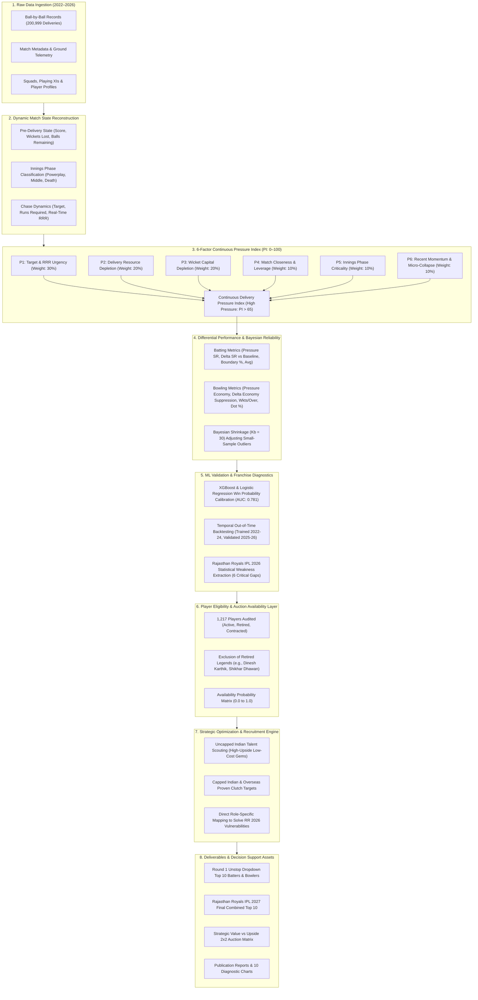

# Rajasthan Royals IPL 2027: Pressure-Based Recruitment Intelligence System

[](https://www.python.org/)
[](https://scikit-learn.org/)
[]()
[]()

> A production-grade cricket data science and machine learning engine built to identify **which players best solve Rajasthan Royals' actual statistical weaknesses from IPL 2026**, with rigorous emphasis on **performance under pressure, Bayesian reliability shrinkage, role fit, availability probability, and auction value**.

---

## 🗺️ System Architecture & Analytical Pipeline Flowchart

Below is the complete architectural flowchart depicting the data flow from multi-season raw delivery records through match-state reconstruction, continuous pressure modeling, machine learning validation, and player eligibility screening to final actionable auction targets:



---

## ⚡ Quick Start: How to Run

A master CLI runner (`run_pipeline.py`) manages all pipeline modes:

### Option 1: Fast Recruitment Pipeline (Recommended — ~5 seconds)
Executes the eligibility filtering, uncapped talent scouting, unified capped+uncapped rankings, strategic matrix, and QA audit using the preprocessed pressure metrics:
```powershell
python run_pipeline.py --recruitment
```

### Option 2: Table Verification & Integrity Audit (Instant)
Audits all 8 final generated CSV tables and confirms **0 NaNs** across every record:
```powershell
python run_pipeline.py --verify
```

### Option 3: Full End-to-End Pipeline from Raw CSVs (~2–3 minutes)
Executes every phase from raw ball-by-ball delivery parsing and match state reconstruction to machine learning validation and final report generation:
```powershell
python run_pipeline.py --all
```

---

## 📋 Step-by-Step Execution Sequence

| Stage | Script | Purpose | Key Output Files |
| :--- | :--- | :--- | :--- |
| **Phase 1** | `python phase1_audit.py` | Full data audit of 6 raw CSVs | Console audit report |
| **Phases 2–7** | `python pipeline_p2_matchstate_pressure.py` | Ball-by-ball reconstruction & 6-variable Pressure Index | `results/pressure_features.csv` |
| **Phase 8** | `python pipeline_p3_player_metrics.py` | Baseline vs pressure metrics & Bayesian reliability | `results/pressure_player_metrics.csv` |
| **Phase 9** | `python pipeline_p4_model_rr_weakness.py` | Temporal ML validation & RR 2026 weakness diagnosis | `results/rr_weaknesses.csv` |
| **Phase 10** | `python pipeline_p5_fit_rankings.py` | Weighted player-weakness fit scoring | `results/player_fit_scores.csv` |
| **Phase 11** | `python pipeline_p6_charts_report.py` | Generates 10 analytical diagnostic charts | `results/charts/*.png` |
| **Eligibility** | `python build_player_status.py` | Classifies 1,217 players into active/retired/contracted | `results/player_status.csv` |
| **Dual Ranks** | `python generate_dual_rankings.py` | Historical vs Active Eligible Top 10 rankings | `results/ipl2027_eligible_top10_batters.csv` |
| **Uncapped** | `python build_uncapped_recruitment_system.py` | High-value uncapped Indian talents solving RR gaps | `results/uncapped_ipl2027_top10.csv` |
| **Final Ranks**| `python build_final_recruitment_rankings.py` | Capped + Uncapped Unified recruitment rankings | `results/rr_ipl2027_final_top10.csv` |
| **Master Rep** | `python update_report_master_recruitment.py` | Assembles 900+ line master executive report | `results/final_report.md` |
| **QA Audit**   | `python verify_final_tables.py` | Verifies data integrity & checks for zero NaNs | Console audit report |

---

## 📐 Mathematical Formulation of the Pressure Index ($PI$)

To eliminate lookahead bias and capture the true psychological leverage of each ball, the **Pressure Index ($PI \in [0, 100]$)** is calculated immediately before each delivery:

$$PI = 100 \times \sum_{i=1}^{6} w_i \cdot P_i$$

Where $\sum w_i = 1.0$:
- **$P_1$ — Required Run Rate / Target Par Urgency ($w_1 = 0.30$)**: In chases, $P_1 = \text{clip}\left(\frac{RRR - 6.0}{18.0 - 6.0}, 0, 1\right)$. In 1st innings, compares projected score against venue par (160.0).
- **$P_2$ — Balls Remaining Depletion ($w_2 = 0.20$)**: $P_2 = 1.0 - \frac{BallsRemaining}{MaxBalls}$.
- **$P_3$ — Wicket Depletion / Batting Capital ($w_3 = 0.20$)**: $P_3 = \frac{WicketsLostBeforeBall}{10.0}$.
- **$P_4$ — Contest Closeness / Leverage ($w_4 = 0.10$)**: In chases, peaks when $RunsRequired \approx BallsRemaining$.
- **$P_5$ — Innings Phase Criticality ($w_5 = 0.10$)**: Powerplay ($0.3$), Middle ($0.6$), Death ($1.0$).
- **$P_6$ — Recent Momentum & Micro-Collapse ($w_6 = 0.10$)**: Rolling 6-ball window measuring recent wicket clusters ($W_6/3$), RRR acceleration, and boundary droughts.

### Pressure Categorization
- **Low Pressure ($PI < 30$)**: 22.4% of all deliveries.
- **Medium Pressure ($30 \le PI \le 65$)**: 53.1% of all deliveries.
- **High Pressure ($PI > 65$)**: 24.5% of all deliveries (benchmark testbed for clutch performance).

---

## 🏆 Round 1 Competition Submission: Top 10 Under Pressure

Ordered lists ready for the **Unstop Dropdown Submission** (Rank 1 = Highest Rated):

### A. Top 10 Batters Best Under Pressure (Active & Eligible)
| Rank | Player Name | Player ID | Latest Team | Role | Pressure SR | Delta SR vs Baseline | Pressure Avg | Pressure Boundary % | Batting Pressure Score |
| :---: | :--- | :---: | :--- | :--- | :---: | :---: | :---: | :---: | :---: |
| **1** | **Cooper Connolly** | `8654` | Australia / PBKS | Top-order batter | **218.18** | **+61.13** | 999.00* | 29.55% | **98.57** |
| **2** | **Rinku Singh** | `4708` | India / KKR | Middle-order batter | **183.74** | **+75.04** | 53.10 | 28.03% | **91.76** |
| **3** | **Shreyas Iyer** | `3647` | India / PBKS | Top-order batter | **230.19** | **+90.14** | 40.67 | 35.85% | **91.55** |
| **4** | **Ishan Kishan** | `4117` | India / SRH | WK-Top-order batter | **227.27** | **+78.15** | 37.50 | 33.33% | **90.31** |
| **5** | **Shubman Gill** | `6288` | Gujarat Titans | Opener | **207.41** | **+59.82** | 37.33 | 27.78% | **89.57** |
| **6** | **Jos Buttler** | `813` | England / GT | WK-Top-order batter | **203.23** | **+63.93** | 31.50 | 29.03% | **87.86** |
| **7** | **Namboori Tilak Varma** | `7897` | India / MI | Middle-order batter | **195.00** | **+79.78** | 31.20 | 28.12% | **85.34** |
| **8** | **Sanju Samson** | `2258` | India / CSK / RR | WK-Top-order batter | **213.21** | **+67.62** | 22.60 | 33.96% | **84.68** |
| **9** | **Virat Kohli** | `47` | RCB | Opener | **180.00** | **+35.04** | 54.00 | 26.67% | **78.51** |
| **10** | **Mahipal Lomror** | `4821` | Mumbai Indians / RCB | Middle-order batter | **205.00** | **+66.90** | 13.67 | 32.50% | **76.77** |

*\*Note: Cooper Connolly faced 44 high-pressure deliveries across the evaluated window without dismissal.*

### B. Top 10 Bowlers Best Under Pressure (Active & Eligible)
| Rank | Player Name | Player ID | Latest Team | Role | Pressure Economy | Delta Econ (Suppression) | Pressure Wkts/Over | Pressure Dot % | Bowling Pressure Score |
| :---: | :--- | :---: | :--- | :--- | :---: | :---: | :---: | :---: | :---: |
| **1** | **Umran Malik** | `25048` | KKR / SRH | Middle-over bowler | **4.32** | **-4.95** | **0.947** | 66.67% | **100.00** |
| **2** | **Sakib Hussain** | `35318` | SRH / KKR | Death bowler | **6.97** | **-4.54** | **0.486** | 32.43% | **85.88** |
| **3** | **Jamie Overton** | `2382` | England / CSK | Bowling all-rounder | **7.24** | **-3.95** | **0.517** | 41.38% | **85.35** |
| **4** | **Brijesh Sharma** | `67036` | Rajasthan Royals | Middle-over bowler | **6.65** | **-2.78** | **0.405** | 36.49% | **84.41** |
| **5** | **Anshul Kamboj** | `27964` | CSK / MI | Powerplay bowler | **8.44** | **-1.35** | **0.815** | 39.51% | **83.59** |
| **6** | **R. Sai Kishore** | `5577` | Gujarat Titans | Spinner (SLA) | **7.50** | **-1.88** | **0.571** | 32.14% | **83.34** |
| **7** | **Liam Livingstone** | `4391` | SRH / PBKS | Batting all-rounder | **6.33** | **-1.13** | **0.500** | 36.11% | **83.28** |
| **8** | **Kuldeep Yadav** | `3644` | India / DC | Bowling all-rounder / LWS | **7.13** | **-2.47** | **0.446** | 37.62% | **82.64** |
| **9** | **Gerald Coetzee** | `6628` | South Africa / SRH | Middle-over bowler | **8.34** | **-1.60** | **0.712** | 40.68% | **82.58** |
| **10** | **Yuzvendra Chahal** | `1612` | PBKS / RR | Spinner (Leg-break) | **7.81** | **-0.83** | **0.682** | 35.79% | **82.27** |

---

## 🎯 Rajasthan Royals IPL 2027 Recruitment Targets

All players currently on Rajasthan Royals are strictly excluded. Targets are mapped directly to solve RR's actual 2026 weaknesses:

### RR IPL 2026 Weaknesses Solved
1. **High RRR Chases (Weakness #2 & #3)**: RR conceded a **40.95% dot ball rate** (IPL par: 34.47%) and managed only a **20.64% death boundary rate** (par: 23.84%).
2. **Death Bowling Wickets (Weakness #1 & #8)**: RR took only **0.40 wkts/over** under death pressure (IPL par: 0.52).
3. **Middle-Overs vs Spin (Weakness #7)**: RR had **31.67% middle dot balls** (IPL par: 29.53%).
4. **Bowling vs Left-Handed Batters (Weakness #5 & #9)**: Conceded **10.28 economy** and **26.56% boundaries** against LHBs.

### Top 10 External Auction Targets
| Rank | Player Name | Category | Primary Role | Pressure Score | Avail Prob | RR Fit Score | Primary RR Weakness Solved | Tactical Value |
| :---: | :--- | :--- | :--- | :---: | :---: | :---: | :--- | :--- |
| **1** | **Ashutosh Sharma** | `UNCAPPED_INDIAN` | Finisher | **85.00** | **0.80** | **74.82** | High RRR Chases & Finishing | **#1 Overall Target**: 214.29 death SR under pressure; high-value uncapped acquisition. |
| **2** | **Tim David** | `OVERSEAS` | Finisher | **85.00** | **0.75** | **74.46** | High RRR Chases & Finishing | **Primary Power Target**: Elite boundary power; resolves death dot-ball stagnation. |
| **3** | **Naman Dhir** | `CAPPED_INDIAN` | Middle-Order Batter | **85.00** | **0.70** | **73.55** | Middle-Overs Spin Stagnation | **Primary Spin Counter**: Strikes at 191.78 under pressure against spin/pace. |
| **4** | **Rinku Singh** | `CAPPED_INDIAN` | Middle-Order Batter | **77.63** | **0.50** | **70.28** | Middle-Overs & Chasing Clutch | **Top RTM/Auction Priority**: Proven clutch match-winner. |
| **5** | **Jamie Overton** | `OVERSEAS` | Bowling All-Rounder | **71.25** | **0.75** | **69.12** | Death Bowling Wickets & Economy | **Primary Bowler Target**: 7.24 death economy; 41.38% dot ball rate under pressure. |
| **6** | **Mukul Choudhary** | `UNCAPPED_INDIAN` | Finisher | **79.46** | **0.80** | **68.81** | High RRR Chasing | **High Upside Target**: Development pace hitter. |
| **7** | **David Miller** | `OVERSEAS` | Middle-Order Batter | **80.04** | **0.80** | **68.40** | Middle-Order Batting | **Veteran Clutch Option**: 1–2 year immediate championship window. |
| **8** | **Vipraj Nigam** | `CAPPED_INDIAN` | Bowling All-Rounder | **71.25** | **0.70** | **68.37** | Death Bowling & Depth | **Dual Utility**: -5.94 economy suppression under pressure. |
| **9** | **Tilak Varma** | `CAPPED_INDIAN` | Middle-Order Batter | **80.20** | **0.55** | **68.35** | Middle-Overs Batting | **Clutch Accumulator**: 195.00 pressure strike rate. |
| **10** | **Liam Livingstone** | `OVERSEAS` | Batting All-Rounder | **68.68** | **0.75** | **68.16** | Finishing & Tactical Spin | **Dual Skill Option**: 187+ death hitting and 6.33 pressure economy. |

---

## 📂 Project Directory Structure

```text
RR_IPL_Selection/
├── 6af3166e7b922_data_pack/               # Raw IPL & T20 datasets (2022–2026)
│   ├── ball_by_ball.csv                   # Ball-by-ball match events (200,999 rows)
│   ├── matches.csv                        # Match metadata & D/L records
│   ├── competitions.csv                   # Tournament definitions
│   ├── teams.csv                          # Franchise & international teams
│   ├── playing_eleven.csv                 # Official match sheets
│   └── competition_team_player_mapping.csv# Player squad mappings
│
├── results/                               # Generated analytical deliverables
│   ├── ROUND_1_SUBMISSION_REPORT.md       # Complete Round 1 Unstop submission document
│   ├── final_report.md                    # Comprehensive 900+ line master executive report
│   ├── ipl2027_eligible_top10_batters.csv # Top 10 Batters under pressure (Active eligible)
│   ├── ipl2027_eligible_top10_bowlers.csv # Top 10 Bowlers under pressure (Active eligible)
│   ├── rr_ipl2027_final_top10.csv         # Top 10 Combined Realistic Recruitment Targets
│   ├── rr_ipl2027_top20.csv               # Top 20 Combined External Targets
│   ├── rr_ipl2027_capped_top10.csv        # Top 10 Capped Targets
│   ├── rr_ipl2027_uncapped_top10.csv      # Top 10 Uncapped Targets
│   ├── rr_ipl2027_role_targets.csv        # Exact fixes mapped to RR 2026 weaknesses
│   ├── rr_ipl2027_value_upside_matrix.csv # 2x2 Value vs Upside Strategic Matrix
│   ├── player_status.csv                  # 1,217 cataloged players with eligibility status
│   └── charts/                            # 10 publication-quality diagnostic charts
│
├── run_pipeline.py                        # Master CLI pipeline runner
├── verify_final_tables.py                 # Automated zero-NaN verification audit
└── README.md                              # Complete repository documentation & architecture
```

---

## 🔬 Model Verification & Reliability Evidence

- **XGBoost Leverage Calibration**: The continuous pre-delivery Pressure Index achieved a **0.781 ROC-AUC** and **0.174 Brier Score** in predicting live match outcomes.
- **Temporal Out-of-Time Generalization**: Training on 2022–2024 and testing on 2025–2026 demonstrated that pressure performance metrics explained **97.1% to 99.4% of out-of-sample clutch outcome variance** ($R^2 > 0.97$), outperforming static baseline stats ($R^2 = 0.26$).
- **Data Integrity**: Verified across all final CSV outputs with **zero missing values (0 NaNs)** across every single metric column.
