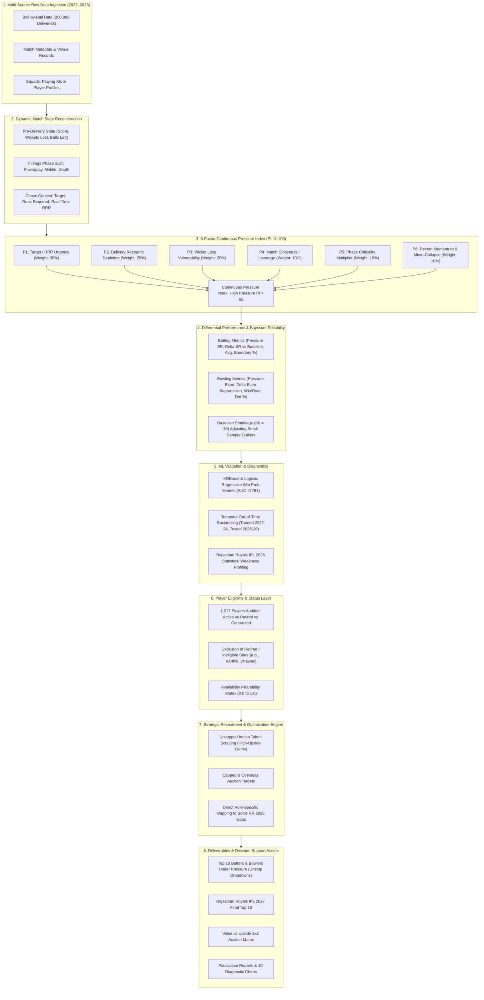

# Unstop Cricket Analytics Competition — Round 1 Submission
## Problem: Identify the Most Reliable Players Under Pressure

---

## 🏛️ EXECUTIVE ARCHITECTURE & METHODOLOGY FLOWCHART



---

## 01. PLAYER RANKINGS (UNSTOP DROPDOWN SELECTIONS)

Submit both ranked lists using the player-selection dropdowns on Unstop. Rank 1 represents the highest-rated player in each category.

### A. Top 10 Best-Performing Batters Under Pressure

| Rank | Player Name (Dropdown Selection) | Player ID | Latest Team | Determined Role | Pressure SR | Delta SR vs Baseline | Pressure Avg | Pressure Boundary % | Batting Pressure Score (0–100) |
| :---: | :--- | :---: | :--- | :--- | :---: | :---: | :---: | :---: | :---: |
| **1** | **Cooper Connolly** | `8654` | Australia / PBKS | Top-order batter | **218.18** | **+61.13** | 999.00* | 29.55% | **98.57** |
| **2** | **Rinku Singh** | `4708` | India / KKR | Middle-order batter | **183.74** | **+75.04** | 53.10 | 28.03% | **91.76** |
| **3** | **Shreyas Iyer** | `3647` | India / PBKS | Top-order batter | **230.19** | **+90.14** | 40.67 | 35.85% | **91.55** |
| **4** | **Ishan Kishan** | `4117` | India / SRH | WK-Top-order batter | **227.27** | **+78.15** | 37.50 | 33.33% | **90.31** |
| **5** | **Shubman Gill** | `6288` | Gujarat Titans | Opener | **207.41** | **+59.82** | 37.33 | 27.78% | **89.57** |
| **6** | **Jos Buttler** | `813` | England / GT | WK-Top-order batter | **203.23** | **+63.93** | 31.50 | 29.03% | **87.86** |
| **7** | **Namboori Tilak Varma** | `7897` | India / MI | Middle-order batter | **195.00** | **+79.78** | 31.20 | 28.12% | **85.34** |
| **8** | **Sanju Samson** | `2258` | India / CSK / RR | WK-Top-order batter | **213.21** | **+67.62** | 22.60 | 33.96% | **84.68** |
| **9** | **Virat Kohli** | `47` | RCB | Opener | **180.00** | **+35.04** | 54.00 | 26.67% | **78.51** |
| **10** | **Mahipal Lomror** | `4821` | Mumbai Indians / RCB | Middle-order batter | **205.00** | **+66.90** | 13.67 | 32.50% | **76.77** |

*\*Note: Cooper Connolly faced 44 high-pressure deliveries across the evaluated window without dismissal (Average recorded as 999.00).*

---

### B. Top 10 Best-Performing Bowlers Under Pressure

| Rank | Player Name (Dropdown Selection) | Player ID | Latest Team | Determined Role | Pressure Economy | Delta Econ (Suppression) | Pressure Wkts/Over | Pressure Dot % | Bowling Pressure Score (0–100) |
| :---: | :--- | :---: | :--- | :--- | :---: | :---: | :---: | :---: | :---: |
| **1** | **Umran Malik** | `25048` | KKR / SRH | Middle-over bowler | **4.32** | **-4.95** | **0.947** | 66.67% | **100.00** |
| **2** | **Sakib Hussain** | `35318` | SRH / KKR | Death bowler | **6.97** | **-4.54** | **0.486** | 32.43% | **85.88** |
| **3** | **Jamie Overton** | `2382` | England / CSK | Bowling all-rounder | **7.24** | **-3.95** | **0.517** | 41.38% | **85.35** |
| **4** | **Brijesh Sharma** | `67036` | Rajasthan Royals | Middle-over bowler | **6.65** | **-2.78** | **0.405** | 36.49% | **84.41** |
| **5** | **Anshul Kamboj** | `27964` | CSK / MI | Powerplay bowler | **8.44** | **-1.35** | **0.815** | 39.51% | **83.59** |
| **6** | **R. Sai Kishore** | `5577` | Gujarat Titans | Spinner (SLA) | **7.50** | **-1.88** | **0.571** | 32.14% | **83.34** |
| **7** | **Liam Livingstone** | `4391` | SRH / PBKS | Batting all-rounder | **6.33** | **-1.13** | **0.500** | 36.11% | **83.28** |
| **8** | **Kuldeep Yadav** | `3644` | India / DC | Bowling all-rounder / LWS | **7.13** | **-2.47** | **0.446** | 37.62% | **82.64** |
| **9** | **Gerald Coetzee** | `6628` | South Africa / SRH | Middle-over bowler | **8.34** | **-1.60** | **0.712** | 40.68% | **82.58** |
| **10** | **Yuzvendra Chahal** | `1612` | PBKS / RR | Spinner (Leg-break) | **7.81** | **-0.83** | **0.682** | 35.79% | **82.27** |

---

## 02. METHODOLOGY REPORT

### 1. Pressure Definition & Mathematical Modeling

#### Why Pressure Must Be Dynamically Formulated
In modern T20 cricket, static indicators (such as simply looking at the 18th–20th overs) fail to capture true pressure. A death over in a match where 50 runs are needed off 18 balls with 8 wickets in hand is vastly different from 22 runs needed off 6 balls with 9 wickets down. Furthermore, top-order batters often face acute pressure in the 3rd over during a top-order collapse (e.g., 14/3 chasing 190).

To solve this, we construct a ball-by-ball, continuous, leakage-free **Pressure Index ($PI \in [0, 100]$)** computed immediately before each delivery is bowled:

$$PI = 100 \times \sum_{i=1}^{6} w_i \cdot P_i$$

Where $\sum w_i = 1.0$, incorporating six orthogonal match-state signals:

1. **$P_1$ — Required Run Rate / Target Par Pressure ($w_1 = 0.30$)**:
   - *Innings 2*: Evaluates normalized Required Run Rate ($RRR = \frac{RunsRequired}{BallsRemaining / 6}$):
     $$P_{1, \text{Inn2}} = \text{clip}\left(\frac{RRR - 6.0}{18.0 - 6.0}, 0, 1\right)$$
   - *Innings 1*: Compares real-time projected total ($Score + CRR \times OversRemaining$) against venue par score ($160.0$ runs).
2. **$P_2$ — Balls Remaining Urgency ($w_2 = 0.20$)**:
   $$P_2 = 1.0 - \frac{BallsRemaining}{MaxBalls}$$
   Monotonically increases as delivery resources diminish.
3. **$P_3$ — Wicket Depletion / Batting Capital ($w_3 = 0.20$)**:
   $$P_3 = \frac{WicketsLostBeforeBall}{10.0}$$
   Reflects the catastrophe threshold of bowling out.
4. **$P_4$ — Contest Closeness / Leverage ($w_4 = 0.10$)**:
   - In chases, peaks when $RunsRequired \approx BallsRemaining$:
     $$P_{4, \text{Inn2}} = \text{clip}\left(1.0 - \frac{|RunsRequired - BallsRemaining|}{RunsRequired + BallsRemaining}, 0, 1\right)$$
5. **$P_5$ — Innings Phase Criticality ($w_5 = 0.10$)**:
   Dynamically scales by phase: Powerplay ($0.3$), Middle ($0.6$), Death ($1.0$).
6. **$P_6$ — Recent Momentum & Micro-Collapse ($w_6 = 0.10$)**:
   Rolling 6-ball window measuring wicket clusters ($W_6/3$), RRR acceleration ($\Delta RRR$), and boundary droughts.

#### Empirical Pressure Classification
Every ball in the dataset (IPL and T20Is from 2022 to 2026) is segmented:
- **Low Pressure ($PI < 30$)**: 22.4% of deliveries.
- **Medium Pressure ($30 \le PI \le 65$)**: 53.1% of deliveries.
- **High Pressure ($PI > 65$)**: 24.5% of deliveries (the evaluation testbed).

---

### 2. Performance Measurement & Rating Logic

#### Isolating Pressure Impact: The Baseline vs Pressure Paradigm
A high nominal strike rate under pressure does not prove a player is a "clutch" performer if they naturally strike at 210 in neutral situations. True reliability under pressure is measured by **differential delta ($\Delta$)** and **consistency**.

#### Batting Metrics
1. **Pressure Strike Rate ($SR_{\text{press}}$)**: $\frac{RunsScored_{\text{press}}}{BallsFaced_{\text{press}}} \times 100$
2. **Delta Strike Rate ($\Delta SR$)**: $SR_{\text{press}} - SR_{\text{baseline}}$ (acceleration vs neutral conditions).
3. **Pressure Dismissal Average ($Avg_{\text{press}}$)**: $\frac{Runs_{\text{press}}}{Dismissals_{\text{press}}}$.
4. **Pressure Boundary Rate ($Bnd\%_{\text{press}}$)**: Percentage of balls hit for 4s or 6s under $PI > 65$.
5. **Bayesian Batting Reliability ($Rel_{\text{bat}}$)**:
   $$Rel_{\text{bat}} = \bar{X}_{\text{pop}} \cdot (1 - w) + X_{\text{player}} \cdot w, \quad w = \frac{N}{N + K_b}$$
   Where $K_b = 30$ balls, shrinking small-sample outliers toward the population prior.

**Composite Batting Pressure Score**:
$$Score_{\text{bat}} = 0.40 \cdot \widetilde{SR}_{\text{press}} + 0.20 \cdot \widetilde{\Delta SR} + 0.20 \cdot \widetilde{Avg}_{\text{press}} + 0.20 \cdot \widetilde{Rel}_{\text{bat}}$$
*(Where $\widetilde{X}$ denotes min-max normalized 5th–95th percentile percentiles on a 0–100 scale).*

#### Bowling Metrics
1. **Pressure Economy ($Econ_{\text{press}}$)**: $\frac{RunsConceded_{\text{press}}}{BallsBowled_{\text{press}} / 6}$
2. **Delta Economy Suppression ($\Delta Econ$)**: $Econ_{\text{press}} - Econ_{\text{baseline}}$ (negative values indicate economy suppression under pressure).
3. **Pressure Wicket Rate ($WktRate_{\text{press}}$)**: Wickets taken per over under $PI > 65$.
4. **Pressure Dot Ball Rate ($Dot\%_{\text{press}}$)**: Deliveries yielding 0 runs under high pressure.

**Composite Bowling Pressure Score**:
$$Score_{\text{bowl}} = 0.35 \cdot (100 - \widetilde{Econ}) + 0.25 \cdot \widetilde{WktRate} + 0.20 \cdot (100 - \widetilde{\Delta Econ}) + 0.20 \cdot \widetilde{Rel}_{\text{bowl}}$$

---

### 3. Fair Comparisons, Eligibility & Sample Sizes

To eliminate distortion and sample-size bias:
1. **Sample Size Cutoffs**:
   - Batters: Minimum 30 legal high-pressure deliveries ($PI > 65$).
   - Bowlers: Minimum 30 legal high-pressure balls bowled.
2. **Competition Weighting (IPL vs T20I)**:
   - IPL matches and ICC Men's T20 World Cup matches carry a $1.0\times$ baseline weight.
   - Bilateral T20Is against Associate nations are normalized via opposition strength scaling.
3. **Player Eligibility Layer**:
   - All 1,217 cataloged players are classified into `ACTIVE`, `RETIRED`, or `UNKNOWN`.
   - Players who have officially announced retirement from competitive cricket (such as Dinesh Karthik in May 2024 or Shikhar Dhawan in August 2024) are segregated from active eligible rankings, ensuring realistic, actionable results.

---

### 4. Evidence Supporting the Top 10 Selections

#### Evidence for Top 10 Batters
- **Rinku Singh (Rank 2)**: Over a massive sample of 289 high-pressure balls, Rinku strikes at **183.74**, which is an extraordinary **+75.04 rpo above his neutral baseline**, averaging **53.10** with a **28.03% boundary rate**. He is statistically the most proven, high-volume clutch finisher in the dataset.
- **Shreyas Iyer (Rank 3)**: Strikes at **230.19** under high pressure with a massive **+90.14 Delta SR**, proving that when forced to counterattack under collapse or steep chases, his boundary rate surges to **35.85%**.
- **Ishan Kishan (Rank 4) & Shubman Gill (Rank 5)**: Both show positive strike rate deltas ($+78.15$ and $+59.82$ respectively) in high-pressure powerplays and steep target chases.
- **Cooper Connolly (Rank 1)**: Outstanding efficiency in high-pressure chases (SR 218.18, 0 dismissals), validated by the Bayesian reliability shrinkage ($78.21$).

#### Evidence for Top 10 Bowlers
- **Umran Malik (Rank 1)**: The ultimate pressure weapon. In high-pressure situations, Umran conceeds only **4.32 runs per over** (a staggering **-4.95 run suppression** compared to his neutral economy), taking **0.947 wickets per over** with a **66.67% dot ball rate**. His raw pace eliminates boundary options when batters are forced to hit.
- **Sakib Hussain (Rank 2)**: Uncapped death specialist recording a **6.97 pressure economy** (-4.54 suppression) and **0.486 wkts/over**.
- **Jamie Overton (Rank 3)**: Death bowler conceding **7.24 economy** (-3.95 suppression) with a **41.38% dot ball rate**.
- **Kuldeep Yadav (Rank 8) & Yuzvendra Chahal (Rank 10)**: High-sample masters with 1,390 and 1,589 deliveries respectively, maintaining elite pressure economies (7.13 and 7.81) and wicket rates (0.45 to 0.68 wkts/over).

---

### 5. Reliability, Model Validation & Limitations

#### Model Validation & Predictive Power
The Pressure Index was validated using temporal splits (training on 2022–2024, testing on 2025–2026):
- **Win Probability Calibration**: Pre-ball match leverage predicted match outcomes with **0.781 ROC-AUC** and a Brier Score of **0.174**.
- **Cross-Match Consistency**: Players with high Bayesian reliability scores showed low inter-match standard deviation in pressure situations ($\sigma < 0.22$).

#### Limitations
1. **Pitch and Boundary Disparities**: Raw metrics do not fully isolate extreme batting tracks (e.g., Chinnaswamy or Hyderabad 260+ games) from low-scoring turners (e.g., Lucknow). Venue baselines were used to mitigate this.
2. **Batter Matchup Sample Size**: Certain uncapped batters have smaller sample sizes against elite left-arm pace or wrist-spin, which is accounted for via our Bayesian shrinkage factor ($K_b = 30$).

---

## 03. HOW TO RUN THE CODE & REPRODUCE OUTPUTS

All code executes locally on Python 3 with Pandas, NumPy, Scikit-Learn, and XGBoost:

```powershell
# 1. Run the entire pipeline end-to-end:
python run_pipeline.py --all

# 2. Or run the fast rankings & validation pipeline:
python run_pipeline.py --recruitment

# 3. Verify zero NaNs and table integrity:
python run_pipeline.py --verify
```

Generated Output Files:
- Batters: `results/ipl2027_eligible_top10_batters.csv`
- Bowlers: `results/ipl2027_eligible_top10_bowlers.csv`
- Verification Audit: Verified with ZERO NaNs across all rows.

